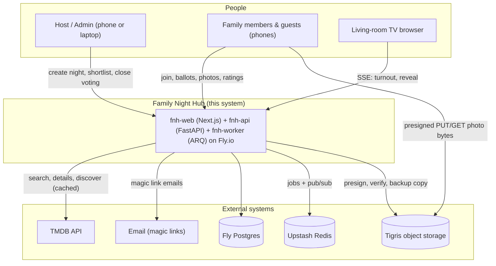

# 01 — System Context

## What Family Night Hub is

Family Night Hub (FNH) is a private, phone-first web app for one family's movie nights. Every
activity is a "night" that people join by scanning a QR code on the fridge or TV. Movie night with
ranked voting is module one. The post-movie photo drop is module two, and both ship in Phase 1.
The core loop:

1. The host creates a night and builds a shortlist of 2–8 titles (Phase 1: by hand with TMDB poster search; Phase 2: generator).
2. The TV shows `/tv` with a QR code and a six-character night code; phones join and each person taps their avatar.
3. Everyone ranks up to three posters (the host votes on behalf of kids without phones). The TV lights up avatars as ballots arrive.
4. The host closes voting; the server tallies, breaks ties deterministically, and the TV reveals the winner.
5. Phones switch to **Tonight**: add photos to the night's private album; later, rate the movie 1–5.

v1 serves a single household. Every table still carries `household_id`, enforced by app code and
Postgres RLS ([ADR-0003](decisions/ADR-0003-household-scoping-app-plus-rls.md)).

## Who uses it (actors / roles)

| Role | Belongs to | UI surface / access | Can do (one line) |
|---|---|---|---|
| Admin | household | `/admin`, magic-link account | Everything: people, devices, history, movies, photos, settings |
| Host | household | `/host/[session]`, magic-link account | Create/run nights, proxy-vote, approve device claims, close voting |
| Member | household | phone via device token | Vote, add photos, react, rate, browse history and albums |
| Guest | household (per night) | phone via device token from night code | Same as member for that night; admin can revoke after |
| TV | household | `/tv` on a TV browser / laptop, paired as a device | Display only: QR, turnout, reveal, slideshow |

**App invariants** (enforced in code, not just convention):
- No request reads or writes another household's rows (RLS + 404s).
- A ballot's `person_id` must be bound to the calling device, or be a host proxy vote.
- Tallies are not readable by anyone until the night is `revealed`.
- Photo bytes are never publicly addressable; every view uses a fresh presigned GET of 10 minutes or less.

## Context diagram (C4-style level 1)

## High-level data flow narrative

**Synchronous.** Every phone action is a REST call from `fnh-web` through `/api` to `fnh-api`,
which resolves the device and household, opens a transaction with the RLS setting, and writes.
Mutations publish a hint to Redis so open streams refetch.

**Live.** Phones and the TV hold one SSE stream per open night ([ADR-0004](decisions/ADR-0004-sse-live-updates.md)).
Snapshots are authoritative; events only say "refetch".

**Async.** `fnh-worker` runs the nightly photo backup, the orphan-upload sweep and the TMDB cache
refresh ([`06-background-worker.md`](06-background-worker.md)).

## Tenancy model

One household in v1. The trust boundary is the household: a device token or admin session belongs
to exactly one household, and that is the only household the request can see. Multi-household needs
a consent/COPPA ADR first.

## External integrations — what's optional, what's not

| Integration | Required? | Used by | If absent |
|---|---|---|---|
| Fly Postgres | Required | api, worker | App down |
| Upstash Redis | Required for jobs + push | api, worker | Live push falls back to polling; jobs pause |
| Tigris | Required for photos | api (presign), worker, phones | Photo drop disabled; voting still works |
| TMDB | Optional | api | Shortlist accepts typed titles without posters |
| Email provider | Required for admin login | api | Admins use an existing session; members unaffected |

## What's intentionally **not** in this system

So you don't go looking:
- No native apps. It's a responsive web app (PWA "add to home screen" is fine).
- No public signup, no multi-household UI, no social sharing of photos.
- No original-resolution photo storage, no video (v1).
- No Plex/Jellyfin sync, no zip export, no other room types (trip planner, potluck…) yet.
- No game-night scoreboard: that already exists as Ctrl+Alt+Defeat, so link to it.
