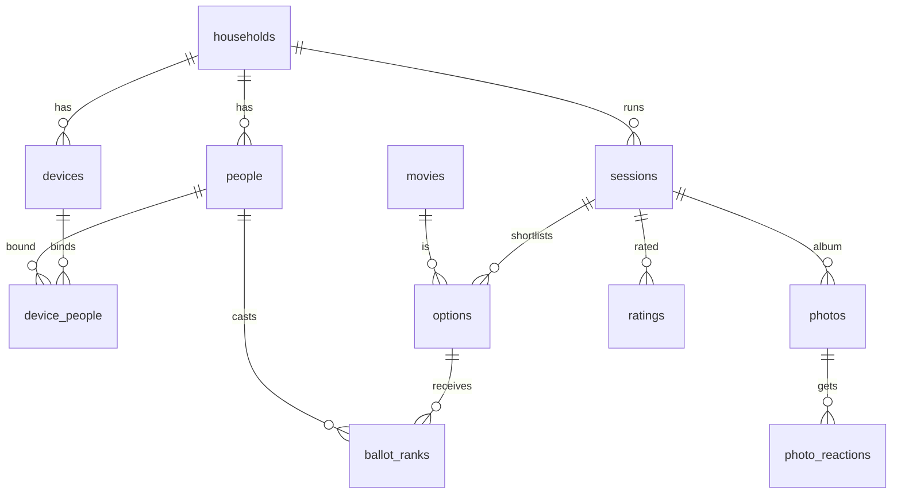

# 05 — Data

PostgreSQL 16 on Fly, SQLAlchemy 2 async, Alembic. Object storage on Tigris (S3 API).

## Model inventory

| Table | Household-scoped? | Purpose |
|---|---|---|
| `households` | root | Name, `join_slug` (rotatable), settings FK |
| `accounts` | yes | Admin/host logins (email, role `admin`/`host`) |
| `magic_links` | yes | Hashed single-use tokens, 15-min expiry |
| `people` | yes | Name, `avatar_emoji`, `color`, `is_guest`, `merged_into_id` |
| `devices` | yes | `token_hash`, label, `last_seen_at`, `revoked_at`, `is_tv` |
| `device_people` | yes | Which people a device may act as (unique per pair) |
| `movies` | yes | `tmdb_id`, title, year, poster_path, genres, runtime, `us_cert`, `owned`, `watchlist`, `blocked` |
| `tmdb_cache` | no (global) | Cached TMDB responses keyed by request, `fetched_at` (refresh at 30 days or less) |
| `sessions` | yes | `status`, `voting_method`, `ballot_size`, `night_code_hash`, `age_cap`, `ranking jsonb`, `tie_seed`, `winner_option_id`, `host_account_id`, timestamps |
| `options` | yes | Shortlisted movie per session, `source` (`manual`/`owned`/`streaming`/`tmdb`) |
| `ballot_ranks` | yes | `session_id`, `person_id`, `option_id`, `rank`, `cast_by_device_id`, `is_proxy` |
| `ratings` | yes | `session_id`, `person_id`, `score 1–5` (unique per pair) |
| `photos` | yes | `session_id`, `person_id`, `object_key`, `thumb_key`, `taken_at`, `bytes`, `status pending/ready/hidden`, `backed_up_at` |
| `photo_reactions` | yes | `photo_id`, `person_id`, `emoji` (unique triple) |
| `settings` | yes | `default_voting_method`, `default_age_cap`, `streaming_providers int[]`, `region` |
| `audit_events` | yes | Who did what (session transitions, winner corrections, merges, revokes, deletes) |

## Key relationships

Integrity constraints: `ballot_ranks` has `unique(session_id, person_id, rank)`,
`unique(session_id, person_id, option_id)` and `check(rank between 1 and 3)`. `ratings` has
`check(score between 1 and 5)`. `sessions.winner_option_id` must belong to the same session
(enforced by a composite FK on `(id, session_id)`).

## RLS

Every household-scoped table has `ENABLE` and `FORCE ROW LEVEL SECURITY` with the policy
`using (household_id = current_setting('app.household_id', true)::uuid)` plus a matching `with check`.
The app connects as `fnh_app` (no `BYPASSRLS`, not the owner). If the GUC is unset, the setting
evaluates to NULL and no rows are visible, so the policy fails closed. The worker sets the GUC per
household it processes. See [ADR-0003](decisions/ADR-0003-household-scoping-app-plus-rls.md).

## Migrations

Alembic, in `backend/migrations/versions/`. Partial indexes and policies are hand-written,
because autogenerate doesn't capture them (a FieldPro lesson). **Every new household-scoped table
ships its RLS policy in the same migration.** `tests/test_rls_coverage.py` fails CI otherwise.
Migrations run as the owner role in the Fly release command and must be expand/contract safe.

## Object storage

Bucket `fnh-photos` (private, no public ACL, no listing for app credentials beyond its prefix).
Key layout: `households/{hid}/sessions/{sid}/{photo_id}.jpg` and `…_thumb.jpg`. Presigned PUTs last
5 minutes; presigned GETs last 10. Bucket `fnh-photos-backup` is written only by the worker using
separate credentials. Deletes remove both copies within 24h. See
[ADR-0005](decisions/ADR-0005-photo-pipeline-and-storage.md).

## Backups

| What | How | Retention |
|---|---|---|
| Postgres | Fly daily snapshots + weekly worker `pg_dump` → backup bucket | 7 snapshots / 8 weekly dumps |
| Photos | Nightly worker copy → `fnh-photos-backup` | Mirror (deletes propagate in 24h or less) |

Restores are rehearsed once before launch (runbook).

## Conventions

UUID primary keys (so sessions and albums are never enumerable), `timestamptz` everywhere, and
soft-hide for photos (`status = hidden`) with hard delete reserved for admins. People are merged by
repointing FKs and setting `merged_into_id`, never by deleting.

## What's intentionally **not** here / **not** built yet

- No original photos, no video, no EXIF beyond `taken_at`.
- No cross-household tables except `tmdb_cache`.
- No analytics tables. History pages query sessions directly.
