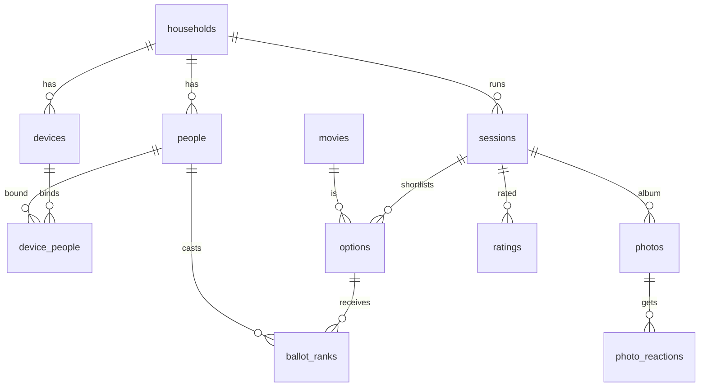

# 05 — Data

PostgreSQL 16 on Fly, SQLAlchemy 2 async, Alembic. Object storage on Tigris (S3 API).

## Model inventory

| Table | Household-scoped? | Purpose |
|---|---|---|
| `households` | root (RLS on `id`) | Name, `join_slug` (rotatable), `deletion_requested_at`/`deletion_requested_by`/`delete_after` (ADR-0017 §4), `disabled_at`/`disable_reminded_at` (ADR-0016). Slug lookup before auth goes through ADR-0009 |
| `household_consents` | yes | ADR-0017 §2: `account_id`, `role`, `terms_version`, `privacy_version`, `guardian`, `accepted_at`. Append-only: `fnh_app` has no UPDATE/DELETE |
| `accounts` | yes | Admin/host logins (email and `username` each unique case-insensitively across households, argon2id `password_hash` + `password_changed_at`, role `admin`/`host`, `disabled_at`) |
| `magic_links` | yes | Hashed single-use tokens, 15-min expiry |
| `people` | yes | Name, `avatar_emoji`, `color`, `is_guest`, `merged_into_id`; ADR-0014: `pin_hash` (argon2id of the peppered PIN), `pin_set_at`, `pin_failed_attempts`, `pin_locked_at`, `name_changed_at` (rename once) |
| `devices` | yes | `token_hash`, label, `last_seen_at`, `revoked_at`, `is_tv` |
| `device_people` | yes | Which people a device may act as (unique per pair); `status` `active`/`pending` (pending = awaiting host approval); `is_current` (the one person the device is acting as; partial unique index, one per device) |
| `pin_reset_requests` | yes | Forgot-PIN requests: `person_id`, `requested_by_device_id`, `status` `open`/`approved`/`dismissed`, `resolved_at`, `resolved_by_account_id`; one open request per person (partial unique index). Never holds a PIN |
| `movies` | yes | `tmdb_id`, title, year, poster_path, genres, runtime, `us_cert`, `owned`, `watchlist`, `blocked` |
| `tmdb_cache` | no (global) | Cached TMDB responses keyed by request, `fetched_at` (refresh at 30 days or less) |
| `sessions` | yes | `status`, `voting_method`, `ballot_size`, `night_code_hash` (unique per household among non-closed nights), `age_cap`, `ranking jsonb`, `tie_seed numeric(20)`, `winner_option_id`, `host_account_id`, `voting_opened_at`/`revealed_at`/`closed_at`, `slideshow_started_at`/`slideshow_stopped_at` (the host's TV slideshow Start/Stop, at most one set, both null = auto; migration `0004_slideshow_control`) |
| `options` | yes | Shortlisted movie per session, `source` (`manual`/`owned`/`streaming`/`tmdb`) |
| `ballot_ranks` | yes | `session_id`, `person_id`, `option_id`, `rank`, `cast_by_device_id` or `cast_by_account_id` (one required), `is_proxy` |
| `ratings` | yes | `session_id`, `person_id`, `score 1–5` (unique per pair). Table ships in Phase 1, UI in Phase 2 |
| `photos` | yes | `session_id`, `person_id`, `object_key`, `thumb_key`, `taken_at`, `bytes`, `status pending/ready/hidden`, `backed_up_at` |
| `photo_reactions` | yes | `photo_id`, `person_id`, `emoji` (unique triple) |
| `photo_deletions` | yes | Tombstone written with each hard delete (`photo_id`, keys, `backup_purged_at`) so the worker can purge backup copies |
| `settings` | yes | `default_voting_method`, `default_age_cap`, `streaming_providers int[]`, `region`, `qr_includes_night_code` (default false; the TV's QR may carry the code, never stored) |
| `session_attendance` | yes | Who is here tonight (G8): `session_id`, `person_id`, `first_seen_at`, unique per (night, person). Written when a phone set to the person opens a live night or votes; read with the ballots by `GET …/present` |
| `audit_events` | yes | Who did what (session transitions, winner corrections, merges, revokes, deletes) |
| `failed_jobs` | no (global) | ARQ dead letters: job name/id/try and a truncated error. Never job args |
| `backup_runs` | no (global) | One row per backup run (`kind` photos/pg_dump, counts, errors) |
| `platform_operators` | no (global) | ADR-0016: `account_id` (PK, FK accounts), `granted_at`, `granted_by`. `fnh_app` SELECT only; the CLI writes it as the owner |
| `platform_audit_events` | no (global) | ADR-0016: every platform action (`account_id`, `household_ref` as a bare id, `action`, `data`). `fnh_app` SELECT/INSERT only |

## Key relationships

Integrity constraints: `ballot_ranks` has `unique(session_id, person_id, rank)`,
`unique(session_id, person_id, option_id)` and `check(rank between 1 and 8)`; `sessions` has
`check(ballot_size between 1 and 8)`. Both were 1..3 until migration `0002_voting_methods_ranks`:
an approval ballot may hold the whole shortlist (up to 8) and stores its approvals as ordinals
1..m, which keeps the rank uniqueness. top3's own `rank ≤ 3` is enforced in `domain/voting`
([ADR-0010](decisions/ADR-0010-approval-and-pick-one-voting.md)). `ratings` has
`check(score between 1 and 5)`. `sessions.winner_option_id` must belong to the same session
(enforced by a composite FK on `(id, session_id)`), and so must a ballot's `option_id`.

**Cross-household references are impossible at the DB level.** Foreign-key checks run
without RLS, so a plain `person_id` FK would accept another household's person. Every
parent exposes `unique(id, household_id)` and every child references it with a composite
FK `(x_id, household_id)`. Composite FKs default to `NO ACTION` (not `RESTRICT`) so a
household-level cascade still succeeds. Constraint names follow the naming convention in
`app/models/base.py`.

## RLS

Every household-scoped table (and `households`, on `id`) has `ENABLE` and `FORCE ROW LEVEL
SECURITY` with the policy `household_isolation`: `using (household_id = app_household_id())`
plus a matching `with check`. `app_household_id()` is
`NULLIF(current_setting('app.household_id', true), '')::uuid`: once a transaction-local GUC
has ended, Postgres reports `''` rather than NULL on that connection, and a bare `::uuid`
cast would error instead of failing closed. The app connects as `fnh_app` (no `BYPASSRLS`,
not the owner); unset GUC means no rows.

**Pre-auth lookups** (device token, magic link, account email or username, join slug, the
worker's household list) go through six `SECURITY DEFINER` functions owned by the `NOLOGIN` role
`fnh_resolver`, which has column-level `SELECT` on four tables and nothing else
([ADR-0009](decisions/ADR-0009-pre-auth-lookups-via-definer-functions.md);
`auth_resolve_account_by_username` and its `accounts.username` grant came with migration
`0003_passwords_person_pins`, [ADR-0014](decisions/ADR-0014-passwords-and-person-pins.md)). The
resolver can never read `password_hash` or `pin_hash`.
`tests/integration/test_rls_coverage.py` pins the table set, the global-table allowlist and
the resolver surface. The worker sets the GUC per
household it processes. See [ADR-0003](decisions/ADR-0003-household-scoping-app-plus-rls.md).

## Migrations

Alembic, in `backend/migrations/versions/`. Partial indexes and policies are hand-written,
because autogenerate doesn't capture them (a FieldPro lesson). **Every new household-scoped table
ships its RLS policy in the same migration.** `tests/test_rls_coverage.py` fails CI otherwise.
Migrations run as the owner role in the Fly release command and must be expand/contract safe.

## Object storage

Tigris bucket names are global across all its users, and `fnh-photos*` were taken, so
the deployed buckets are `fnh-rbj-photos-staging`, `fnh-rbj-photos` and
`fnh-rbj-photos-backup`; diagrams and ADR-0005 keep the short conceptual names.

Bucket `fnh-rbj-photos` (private, no public ACL, no listing for app credentials beyond its prefix).
Key layout: `households/{hid}/sessions/{sid}/{photo_id}.jpg` and `…_thumb.jpg`. Presigned PUTs last
5 minutes and sign `Content-Type: image/jpeg`; presigned GETs last 10. `photos.bytes` is the full
image's size as HEAD reported it on `complete`; `photos.taken_at` holds the EXIF date at midnight
UTC (the phone sends a date only). Reactions are limited to a six-emoji allowlist in the service. Bucket `fnh-rbj-photos-backup` is written only by the worker using
separate credentials. Deletes remove both copies within 24h. See
[ADR-0005](decisions/ADR-0005-photo-pipeline-and-storage.md).

## Backups

| What | How | Retention |
|---|---|---|
| Postgres | Fly daily snapshots + weekly worker `pg_dump` → backup bucket | 7 snapshots / 8 weekly dumps |
| Photos | Nightly worker copy → `fnh-rbj-photos-backup` | Mirror (deletes propagate in 24h or less) |

Restores are rehearsed once before launch (runbook).

## Conventions

UUID primary keys (so sessions and albums are never enumerable), `timestamptz` everywhere, and
soft-hide for photos (`status = hidden`) with hard delete reserved for admins. People are merged by
repointing FKs and setting `merged_into_id`, never by deleting (collision rules in
[03-backend.md](03-backend.md) "People and devices admin"). Unmerged names are unique per household,
case-insensitively, enforced by the service rather than an index. Revoked devices are kept, never deleted.

## What's intentionally **not** here / **not** built yet

- No original photos, no video, no EXIF beyond `taken_at`.
- No cross-household tables except `tmdb_cache`, `failed_jobs`, `backup_runs`, `platform_operators` and `platform_audit_events` (no household data in any).
- One more definer role: `fnh_platform` owns `platform_list_households()` (metadata and counts only; ADR-0016), with column grants and `platform_metadata` SELECT policies on six tables. `test_rls_coverage.py` pins it.
- No analytics tables. History pages query sessions directly.
