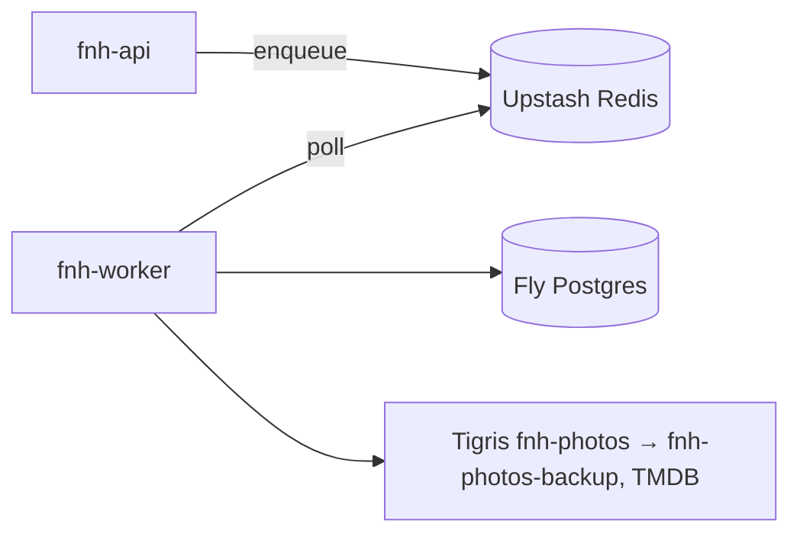

# 06 — Background Worker

ARQ on Upstash Redis. It runs as the separate Fly app `fnh-worker` from the same image as `fnh-api`
(`python -m app.workers.main`). The FieldPro ARQ pitfalls apply: no shared `ctx["db"]` session,
record dead letters via `after_job_end` on `result_info.success`, and use `curl` for health checks.

## How it fits

## Registered tasks

| Task | Trigger | What it does | Status |
|---|---|---|---|
| `backup_new_photos` | cron 03:00 local daily | Copy `ready` photos with `backed_up_at IS NULL` to the backup bucket; stamp `backed_up_at` | Not built: lands with the photo pipeline |
| `propagate_photo_deletes` | cron 03:30 daily | Delete backup objects listed in `photo_deletions` with `backup_purged_at IS NULL`; stamp it | Not built: lands with the photo pipeline |
| `sweep_orphan_uploads` | cron hourly at :40 | Delete `pending` photo rows older than 24h and any objects under their keys (storage first, then the row) | **Built.** Storage is a no-op `ObjectStore` until the pipeline adds a real client |
| `refresh_tmdb_cache` | cron weekly | Re-fetch cached movie details older than 30 days (TMDB caching terms) | Not built: lands with TMDB |
| `pg_dump_weekly` | cron Sunday 04:00 | `pg_dump` to the backup bucket; keep 8. **Open:** `fnh_app` cannot dump RLS-forced tables, so this needs a dedicated read-only role and its own ADR before it is built | Blocked on an ADR |
| `auto_close_stale_sessions` | cron hourly at :10 | Move nights revealed more than 24h ago to `closed` (stamp `closed_at`, write a `session.auto_closed` audit row in the same statement). Covers `revealed` as well as `tonight`, because revealed → tonight is lazy (03) and an untouched night stays `revealed` in the table | **Built** |

Unbuilt tasks are deliberately **not** registered as stubs. A no-op cron would look healthy while
doing nothing.

Every task lists households with `worker_list_household_ids()` (ADR-0009) and works inside
`household_session(hid)`, which sets `app.household_id` per transaction, so RLS stays on for the
worker. Each household gets its own transaction. One household failing is logged, sent to Sentry
and skipped. The others still run, and the job then fails as a whole (a counts-only message) so it
is dead-lettered. Cron times are America/Chicago (`tzdata` ships the zone database: slim images
and Windows lack one). Code: `backend/app/workers/` (`main.py` settings and lifecycle,
`tasks.py` task bodies), tests in `backend/tests/integration/test_worker_*.py`.

## Lifecycle & reliability

Startup initialises Sentry and structlog. A `failed_jobs` table plus Sentry act as the dead-letter
queue. `after_job_end` records every job whose `result_info.success` is false, cron jobs
included, unlike FieldPro, where crons skip the table. A row holds the job name, id, try and the
exception's type plus first line (truncated to 500 characters), and **never args or kwargs**.
Cron failures retry on the next tick. ARQ's own logs go to stdlib logging at WARNING, because at
INFO ARQ prints every job's args.

The worker's `/health` (port `WORKER_HEALTH_PORT`, 8081) is a stdlib listener checked by Fly and by
compose with `curl`. It is liveness only: it never touches Postgres or Redis, so a database
failover can't put the worker into a restart loop. The worker runs continuously as one machine
(02 explains why it cannot auto-stop). The
backup task is idempotent (copy-if-absent by key), so a missed night catches up the next night.
Each backup run writes a `backup_runs` row (objects copied, bytes, errors), and the admin home page
shows the last successful run.

## Gotchas

- The backup credentials exist only in `fnh-worker` secrets. If the API is ever compromised, the
  attacker can't delete the backups.
- Upstash supports DB 0 only. ARQ uses the `arq:` prefix and SSE uses `session:*` channels on the same instance.

## What's intentionally **not** here / **not** built yet

- No server-side thumbnailing or HEIC conversion (the phone does it).
- No email notifications ("rate last night") in v1. Prompts appear in-app instead.
