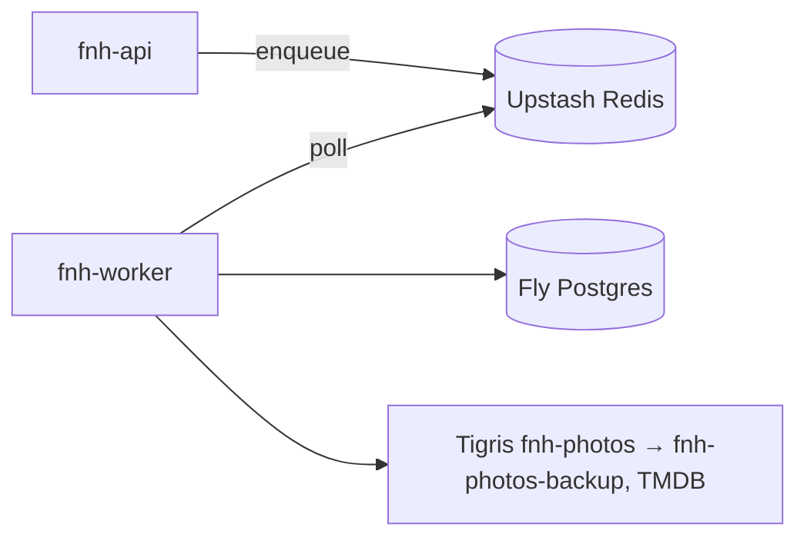

# 06 — Background Worker

ARQ on Upstash Redis. It runs as the separate Fly app `fnh-worker` from the same image as `fnh-api`
(`python -m app.workers.main`). The FieldPro ARQ pitfalls apply: no shared `ctx["db"]` session,
record dead letters via `after_job_end` on `result_info.success`, and use `curl` for health checks.

## How it fits

## Registered tasks

| Task | Trigger | What it does |
|---|---|---|
| `backup_new_photos` | cron 03:00 local daily | Copy `ready` photos with `backed_up_at IS NULL` to the backup bucket; stamp `backed_up_at` |
| `propagate_photo_deletes` | cron 03:30 daily | Delete backup objects for photos hard-deleted in the last day |
| `sweep_orphan_uploads` | cron hourly | Delete `pending` photo rows older than 24h and any objects under their keys |
| `refresh_tmdb_cache` | cron weekly | Re-fetch cached movie details older than 30 days (TMDB caching terms) |
| `pg_dump_weekly` | cron Sunday 04:00 | `pg_dump` to the backup bucket; keep 8 |
| `auto_close_stale_sessions` | cron hourly | Move nights left in `tonight` for more than 24h to `closed` |

Every task iterates households and sets `app.household_id` per household (RLS stays on for the worker).

## Lifecycle & reliability

Startup initialises Sentry and structlog. A `failed_jobs` table plus Sentry act as the dead-letter
queue. Cron failures retry on the next tick. The worker's `/health` port is checked by Fly. The
backup task is idempotent (copy-if-absent by key), so a missed night catches up the next night.
Each backup run writes a `backup_runs` row (objects copied, bytes, errors), and the admin home page
shows the last successful run.

## Gotchas

- The backup credentials exist only in `fnh-worker` secrets. If the API is ever compromised, the
  attacker can't delete the backups.
- Upstash supports DB 0 only. ARQ uses the `arq:` prefix and SSE uses `session:*` channels on the same instance.

## What's intentionally **not** here / **not** built yet

- No server-side thumbnailing or HEIC conversion (the phone does it).
- No email notifications ("rate last night") in v1. Prompts appear in-app instead.
