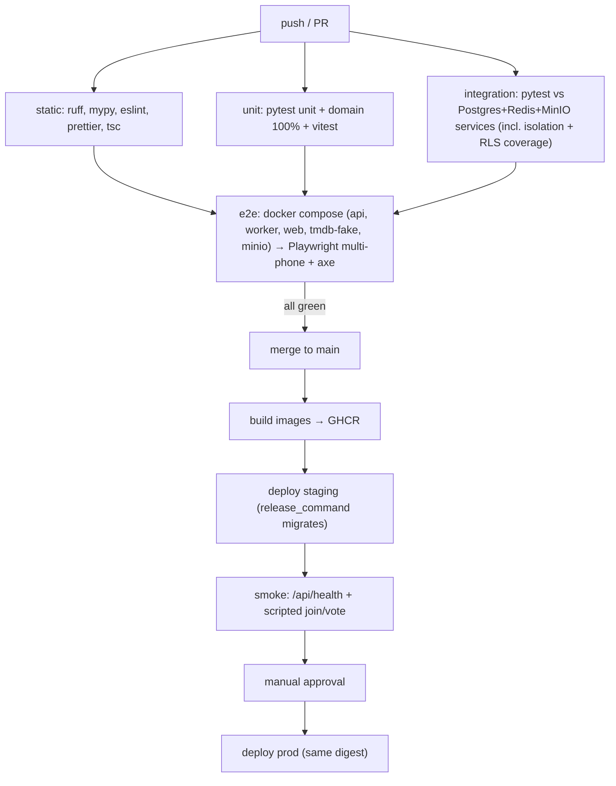

# 07 — CI/CD

No pipeline exists yet (the repo is empty). This is the intended pipeline. It combines OrderUp's
Fly deploy with CAD's "secret never in bundle" and multi-browser Playwright gates. The owner is a
QA/CI engineer, so the bar is **deterministic, trustworthy green**.

## The full pipeline at a glance

## CI jobs

| Job | Purpose | Source of truth |
|---|---|---|
| `static` | ruff, mypy, eslint, prettier, `tsc --noEmit` | `.github/workflows/ci.yml` |
| `unit` | pytest `tests/unit` (+ Hypothesis tally properties), vitest (photo pipeline incl. GPS-strip fixture) | `backend/tests/unit`, `frontend/src/**/*.test.ts` |
| `integration` | pytest against real Postgres/Redis/MinIO service containers | `backend/tests/integration` |
| `isolation` | two-household seed; every endpoint and table returns nothing cross-household; `test_rls_coverage` | `backend/tests/integration/test_isolation.py` |
| `contract` | `openapi.json` and `api.gen.ts` drift check; Alembic `check` (models match migrations) | ci.yml |
| `e2e` | compose stack, Playwright: 4 phone contexts (iPhone + Pixel descriptors) + TV context; unauthenticated context must get 0 photo URLs; axe | `frontend/e2e/` |
| `bundle-secrets` | build web, grep `.next/static` for every server secret value | ci.yml |

**Coverage / quality gates:** `app/domain/**` at 100% line coverage, services at 80% or more,
overall at 70% or more, with ratchets that only go up. Any test using `waitForTimeout` or `sleep`
fails lint. E2E retries = 0 on PRs. A flaky test is quarantined with an issue, never retried into
green.

**E2E determinism rules:** wait for `data-live="ready"` before acting; assert on server-derived
text with `expect.poll`/`toHaveText`; tie-break seeds are injected through a test-only header that
is accepted only when `ENVIRONMENT=test`; TMDB is always `tmdb-fake`.

## Deploy workflow

On a merge to `main`, `deploy.yml` builds one image for api and worker and one for web, then
pushes them to GHCR tagged with the SHA. It deploys staging (`fly deploy --image …`), where the
release command runs Alembic, then runs a smoke test. The `production` GitHub environment requires
the owner's approval and deploys the **same digests**. Rollback means redeploying the previous
digest. Migrations are expand/contract, so rolling back code never needs a down-migration.

## Secrets map

| Secret | Where stored | Consumed by |
|---|---|---|
| `FLY_API_TOKEN` (staging, prod) | GitHub environments | deploy.yml |
| `GHCR` push | `GITHUB_TOKEN` | deploy.yml |
| App secrets | `fly secrets` (see [`02-environments.md`](02-environments.md)) | Fly apps |
| CI test secrets | none needed (local services, tmdb-fake) | — |

## What CI does NOT enforce

Worth knowing so you don't assume green means safe:
- Real iOS Safari HEIC behaviour. WebKit in Playwright is not iOS, so there is a manual iPhone checklist before each release that touches photos.
- Live TMDB terms and parameter behaviour, because CI uses the fake. Re-verify against the live docs before building the generator.
- Load, backup restore (rehearsed manually), and keeping the docs in sync with the code.
