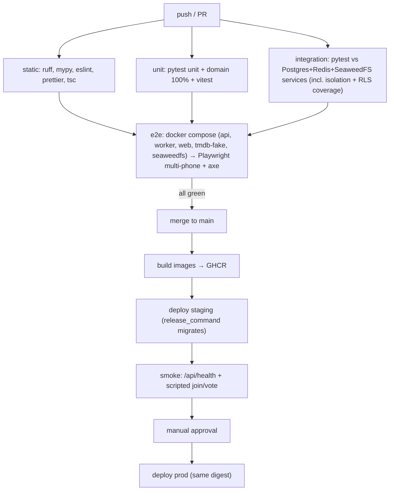

# 07 — CI/CD

`ci.yml` exists with the `static`, `unit`, `integration`, `contract` and `bundle-secrets` jobs
(status column below), and `deploy.yml` is built (below). `e2e` is still intended, not built. It combines OrderUp's
Fly deploy with CAD's "secret never in bundle" and multi-browser Playwright gates. The owner is a
QA/CI engineer, so the bar is **deterministic, trustworthy green**.

## The full pipeline at a glance

## CI jobs

| Job | Purpose | Source of truth | Status |
|---|---|---|---|
| `static` | ruff check + format, mypy strict, repo rules (`backend/scripts/check_repo_rules.py`: no sleeps/fixed waits in tests, no session-level `app.*` GUC, revision ids of 32 chars or fewer), actionlint 1.7.7 over every workflow, `tsc --noEmit` | `.github/workflows/ci.yml` | Built. eslint/prettier land with the first real UI |
| `unit` | pytest `tests/unit` (+ Hypothesis tally properties), vitest (photo pipeline incl. GPS-strip fixture) | `backend/tests/unit`, `frontend/src/**/*.test.ts` | pytest built; vitest lands with the photo pipeline |
| `integration` | Whole pytest suite against Postgres + Redis service containers as `fnh_app`, after the role bootstrap. **Includes the isolation suite** (two seeded households, every table) and `test_rls_coverage`. Coverage gates run here | `backend/tests/integration` | Built. SeaweedFS service joins with the photo endpoints; endpoint-level isolation joins with the endpoints |
| `contract` | `alembic upgrade` → `downgrade base` → `upgrade` round trip, `alembic check` (models match migrations), `openapi.json` + `api.gen.ts` drift | ci.yml | Built |
| `e2e` | compose stack, Playwright: 4 phone contexts (iPhone + Pixel descriptors) + TV context; unauthenticated context must get 0 photo URLs; axe | `frontend/e2e/` | Not built |
| `bundle-secrets` | `next build` with sentinel values for every server secret, then grep `.next/static` for each. Verified by a deliberate leak (`next.config` `env` + client component) that the grep catches | ci.yml | Built |

`ENVIRONMENT=test` in CI. TypeScript types come from `openapi-typescript`, installed in its own
package (`frontend/tools/openapi/`) because it needs a TypeScript 5 peer and the app runs
TypeScript 7.

**Coverage / quality gates:** `app/domain/**` at 100% line coverage, services at 80% or more,
overall at 70% or more (all three enforced in the `integration` job), with ratchets that only go up. Any test using `waitForTimeout` or `sleep`
fails lint. E2E retries = 0 on PRs. A flaky test is quarantined with an issue, never retried into
green.

**E2E determinism rules:** wait for `data-live="ready"` before acting; assert on server-derived
text with `expect.poll`/`toHaveText`; tie-break seeds are injected through a test-only header that
is accepted only when `ENVIRONMENT=test`; TMDB is always `tmdb-fake`.

## Deploy workflow

`.github/workflows/deploy.yml` runs when **CI completes successfully for a push to `main`**
(`workflow_run`), not on the push itself, so a main commit whose CI failed is never deployed. It
can also be run by hand (`workflow_dispatch`) after provisioning.

1. **build** (matrix): one image for api + worker (`backend/`), one for web (`frontend/`). Both are
   pushed to GHCR as `ghcr.io/<owner>/fnh-{backend,web}:sha-<commit>`, and each digest is handed
   on as an artifact.
2. **deploy-staging** (GitHub environment `staging`): pull both images **by digest**, then
   `flyctl deploy --image … --local-only` for `fnh-api-staging` (its `release_command` runs
   Alembic before new machines start; `--no-public-ips`), `fnh-worker-staging` and
   `fnh-web-staging`, in that order. Then the smoke test: `GET
   https://fnh-web-staging.fly.dev/api/health` must return `status: ok`, which exercises web →
   Flycast → api → Postgres (RLS path) + Redis. The scripted join/vote smoke lands with e2e.
3. **deploy-production** (GitHub environment `production`, required reviewer): the **same
   digests**, through the same steps with `deploy/prod/*`.

`--local-only` pushes from the runner's Docker daemon to Fly's registry, so Fly never needs GHCR
credentials (OrderUp pattern). Rollback means redeploying the previous `sha-<commit>` image
without the release command ([runbook §3](../runbooks/restore.md#3-roll-back-a-deploy)).
Migrations are expand/contract, so rolling back code never needs a down-migration.

**Inert until provisioned.** Each deploy job reads `FLY_API_TOKEN` from its environment. If it is
empty, the job emits a notice and skips its steps instead of failing `main`, and production then
skips too. **Give `production` its required reviewer before adding its token.** GitHub creates a
referenced environment without protection rules.

## Secrets map

| Secret | Where stored | Consumed by |
|---|---|---|
| `FLY_API_TOKEN` (staging, prod) | GitHub environments `staging`, `production` | deploy.yml |
| `GHCR` push | `GITHUB_TOKEN` | deploy.yml |
| App secrets | `fly secrets` (see [`02-environments.md`](02-environments.md)) | Fly apps |
| CI test secrets | none needed (local services, tmdb-fake) | — |

## What CI does NOT enforce

Worth knowing so you don't assume green means safe:
- Real iOS Safari HEIC behaviour. WebKit in Playwright is not iOS, so there is a manual iPhone checklist before each release that touches photos.
- Live TMDB terms and parameter behaviour, because CI uses the fake. Re-verify against the live docs before building the generator.
- Load, backup restore (rehearsed manually), and keeping the docs in sync with the code.
