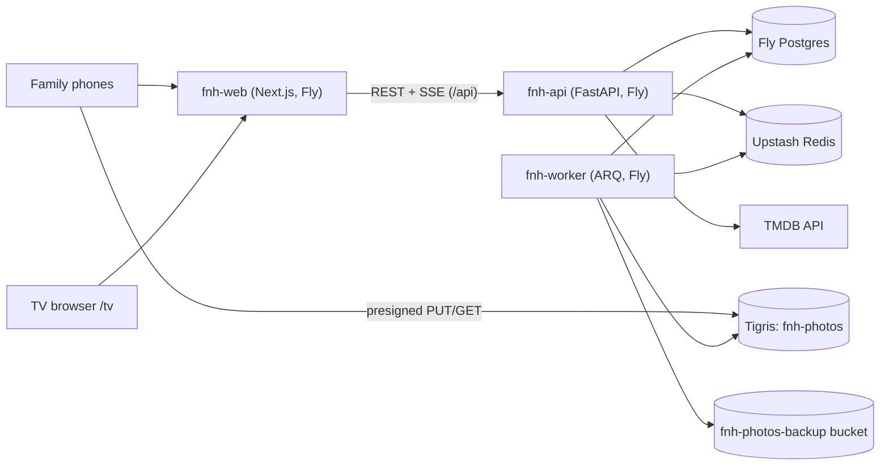

# Family Night Hub Architecture

This folder is the **map of the system**. If you've been away for a while and don't remember how
Family Night Hub (FNH) fits together — start here.

FNH is a private web app for one family. On movie night the host builds a shortlist, everyone scans
a QR code, ranks their top 3 on a phone (or the host votes for the little ones), the TV reveals the
winner, and afterwards everyone drops photos into a private album. It runs as three Fly.io apps —
a Next.js frontend, a FastAPI API and an ARQ worker — backed by Postgres, Redis and Tigris object
storage. It follows the OrderUp / MadeFresh skeleton and inherits the Ctrl+Alt+Defeat visual design.

## How to read this folder

The numbered docs go **broad → narrow**.

| File | What it covers | When to read |
|---|---|---|
| [`01-system-context.md`](01-system-context.md) | What FNH is, who uses it, the C4 context diagram, the movie-night loop | First, always |
| [`02-environments.md`](02-environments.md) | Local (Docker Compose), staging + production on Fly, secrets, cost | Before touching a deploy, secret or Fly config |
| [`03-backend.md`](03-backend.md) | FastAPI layout, device/admin auth, household scoping, voting + tally, SSE, TMDB | Before adding or editing an endpoint |
| [`04-frontend.md`](04-frontend.md) | Next.js routes (`(public)`, `/host`, `/tv`, `/admin`), phone state machine, photo pipeline, design tokens | Before adding or editing a page |
| [`05-data.md`](05-data.md) | Postgres schema, RLS, migrations, object-storage layout, backups | Before writing a migration or query |
| [`06-background-worker.md`](06-background-worker.md) | ARQ tasks: photo backup, orphan cleanup, TMDB cache refresh | Before adding a background job |
| [`07-cicd.md`](07-cicd.md) | CI gates (static, pytest + isolation, Playwright multi-phone), deploy workflow | Before changing the pipeline |

**Highest-risk decisions:**

| Decision | ADR |
|---|---|
| Host on Fly.io with the OrderUp skeleton (supersedes the Supabase plan) | [`ADR-0001`](decisions/ADR-0001-fly-fastapi-postgres-hosting.md) |
| Family members are device tokens bound to a person, not accounts | [`ADR-0002`](decisions/ADR-0002-device-identity-and-join-flow.md) |
| Household scoping enforced in app code *and* Postgres RLS | [`ADR-0003`](decisions/ADR-0003-household-scoping-app-plus-rls.md) |
| Live updates over SSE + Redis pub/sub with single-use tickets | [`ADR-0004`](decisions/ADR-0004-sse-live-updates.md) |
| Photos processed on the phone, direct-to-Tigris, private, backed up nightly | [`ADR-0005`](decisions/ADR-0005-photo-pipeline-and-storage.md) |
| Top-3 ranked voting rules and deterministic tie-break | [`ADR-0006`](decisions/ADR-0006-voting-rules-and-tie-break.md) |
| Candidate generator draws owned → streaming → TMDB | [`ADR-0007`](decisions/ADR-0007-candidate-generator-order.md) |
| Inherit Ctrl+Alt+Defeat design tokens | [`ADR-0008`](decisions/ADR-0008-ctrl-alt-defeat-design-tokens.md) |
| Pre-auth lookups (device, magic link, slug) via narrow definer functions | [`ADR-0009`](decisions/ADR-0009-pre-auth-lookups-via-definer-functions.md) |

## The 30-second mental model

**What the diagram shows:**

- Phones and the TV only talk to `fnh-web`; it proxies `/api/*` to `fnh-api` so cookies stay same-site.
- Photo bytes never pass through the API: phones PUT to Tigris with a presigned URL the API minted, and view with short-lived presigned GETs.
- Redis carries both the ARQ queue and the SSE fan-out channel (`session:{id}`); if Redis drops, phones fall back to polling.
- Only `fnh-api` holds the TMDB key; responses are cached in Postgres.

## Source-of-truth files (start here when documentation rots)

If anything in these docs disagrees with the code below, the code wins. (Paths are the planned layout.)

| Concern | Authoritative file(s) |
|---|---|
| API app factory + middleware order | `backend/app/main.py` |
| Household scoping dependency + RLS GUC | `backend/app/core/dependencies.py`, `backend/app/core/database.py` |
| Device/admin auth | `backend/app/core/security.py`, `backend/app/api/v1/join.py` |
| Tally modules | `backend/app/domain/voting/` |
| Session state machine | `backend/app/domain/session_state.py` |
| Migrations + RLS policies | `backend/migrations/versions/` |
| Worker task registry | `backend/app/workers/main.py` |
| Photo processing (client) | `frontend/src/lib/photos/` |
| Design tokens | `frontend/src/app/globals.css` |
| Generated API types | `frontend/src/types/api.gen.ts` (from `backend/openapi.json`) |
| CI / deploy | `.github/workflows/ci.yml`, `.github/workflows/deploy.yml` |
| Fly config | `deploy/{staging,prod}/*.fly.toml`, `frontend/Dockerfile` (+ `docker-entrypoint.sh`) |
| Provisioning, restore, rollback | `docs/runbooks/restore.md` |

## Glossary — what's that thing?

| Term | What it is |
|---|---|
| Fly.io | Container host running our three apps (web, api, worker) as Fly Machines |
| Fly Postgres / Tigris | Fly's managed Postgres and its S3-compatible object storage |
| Upstash Redis | Hosted Redis used for the ARQ queue and SSE pub/sub |
| FastAPI / Pydantic / SQLAlchemy / Alembic | Python web framework / validation / ORM / migrations |
| ARQ | Async Redis job queue for Python (same as FieldPro/OrderUp) |
| SSE | Server-Sent Events: one-way server→browser stream via `EventSource` |
| RLS / GUC | Postgres row-level security; a GUC is a per-session setting (`app.household_id`) the policies read |
| TMDB | The Movie Database API — metadata, posters, certifications, watch providers |
| HEIC | Apple's default photo format; we decode it on the phone and re-encode JPEG |
| Device token | Opaque credential stored in an httpOnly cookie that ties a phone to a household (and optionally a person) |
| Session (movie night) | One movie night: `draft → voting → revealed → tonight → closed` |
| Borda (top-3) | Ranked scoring: rank 1/2/3 = 3/2/1 points |
| CAD | Ctrl+Alt+Defeat (`gaming-league-tracker`), source of the design tokens |

## Adjacent reading

- [`BUILD-PROMPT.md`](BUILD-PROMPT.md) — hand-off prompt for the builder.
- Sibling references: OrderUp `docs/architecture/` (SSE, RLS-GUC), FieldPro `CLAUDE.md` (tenancy, ARQ pitfalls), CAD `docs/architecture/` (tokens, Playwright patterns).

## When this folder goes stale

These docs describe the **intended** system as of **2026-10-15**; code exists for the backend
skeleton and the Phase 1 schema (migration `0001`). They will rot:

- **Adding a service / environment / background task / CI job** → update the relevant chapter in the same PR.
- **Renaming a file or moving a route** → keep the Source-of-truth table current first.
- **A new load-bearing decision** → open a new ADR in `decisions/` (never edit an accepted one).
