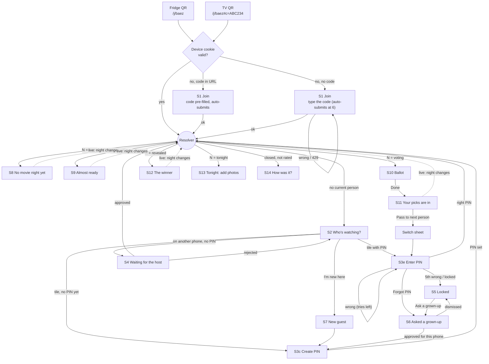

# Proposal: the guest and member flow (QR → night → profile → PIN → vote)

**Status:** Proposal for owner review (issue #36). Nothing here is built yet.
**Builds on:** [ADR-0002](../decisions/ADR-0002-device-identity-and-join-flow.md) (device identity
and join), [ADR-0004](../decisions/ADR-0004-sse-live-updates.md) (live updates),
[ADR-0008](../decisions/ADR-0008-ctrl-alt-defeat-design-tokens.md) (tokens, 56px+ targets) and
ADR-0014 (passwords and required person PINs), which is being written in a parallel session as
this proposal is drafted. ADR-0014 was read as a working draft from that session's worktree, and
its routes were not written yet. Re-check §8 against the merged ADR before building.
**Consumer:** the frontend session that builds ADR-0014's screens.

---

## 1. Executive summary

The first phone test on staging (2026-10-17) got stuck on *"You're in as RooDog. Voting opens on
the TV."*, a screen with nothing to tap while voting was open. PR #35 fixed that one bug. The cause
underneath is structural: today's flow is a chain of **stations** (`/j` → `/who` → a button →
`/s/[id]`). Each station waits for the user to find the next step, and each can go stale.

This proposal replaces the stations with **one resolver**. The phone always asks "who is this
phone acting as, and what is the night doing?" and shows the single screen that answers it. The
screen changes by itself when either answer changes. Concretely:

1. **The phone never needs to tap through to the night.** Once it has a current person, it lands
   on the night: the ballot while voting is open, the winner after the reveal, the photo drop
   during the movie.
2. **The TV QR carries the night code** (in the URL fragment, RFC 8628's
   `verification_uri_complete` pattern), so a first-time guest never types it. The fridge QR stays
   a door with no key, and typing the code is the fallback.
3. **A returning phone skips the code and the PIN.** Its device cookie is already the credential
   (ADR-0002), and it is already set to its person (ADR-0014 `is_current`).
4. **ADR-0014 fits into one sheet over the avatar grid**: a big keypad that submits on the 6th
   digit. It covers enter PIN, create PIN, wrong PIN, locked and "Ask a grown-up". Each state
   leads to a next action, never to a dead end.
5. **Every waiting screen says what it is waiting for, shows live progress, and moves on by
   itself**, and it always offers one way out.

The target is **QR scan to ballot cast in under 30 seconds** for a first-time guest who scans the
TV QR (about 27 s budgeted, §6), and about 12 s for a returning phone. A first-timer who scans the
fridge QR and types the code comes in at about 35 s. That gap is why the TV QR matters (§8, G1).

Four backend gaps against ADR-0014's API need closing before the frontend can meet this spec
(§8). The biggest are: the TV can't get the join slug, the person tile doesn't say a PIN reset is
pending, and the wrong-PIN error needs a machine-readable `attempts_left`. Three questions for the
owner are in §10.

---

## 2. Research findings

Sources were read on 2026-10-17. The Kahoot and Jackbox findings come partly from secondary
sources, as marked.

| Product | What it does | Takeaway for us |
|---|---|---|
| **Kahoot** | No account. You join by entering a game PIN, opening a link, or scanning a QR. An optional nickname generator spins a name for you. The lobby echoes your name on the big screen. Rejoining after leaving usually means a new nickname. ([support.kahoot.com](https://support.kahoot.com/hc/articles/360039890713), search snippet only; [digitalcitizen.life](https://www.digitalcitizen.life/how-to-join-a-kahoot-game-web-mobile/)) | Adopt QR-or-code entry and the echo on the big screen. Reject the weak rejoin. |
| **Jackbox** | A 4-letter room code plus a name at jackbox.tv. The code stays on the TV all game. The first player to join is the VIP. Reconnecting means retyping the code and the *exact* same name; otherwise you land in the audience. (Secondary sources: [fullcoll.edu](https://library.fullcoll.edu/?p=17782), [jackboxgames.com](https://jackboxgames.com/the-jackbox-party-pack-5-streamers-guide/)) | Adopt "the code stays on the TV". Reject name-matching reconnects: our device token resumes in one tap. |
| **Netflix** | A 4-digit Profile Lock per profile. "Forgot PIN?" re-verifies the account (password, email or SMS). There is an option to require the PIN to add new profiles. Kids profiles cap the maturity rating and can't reach settings. ([help.netflix.com](https://help.netflix.com/en/node/114277)) | Adopt the avatar-tile picker and a per-profile PIN. Reject self-service reset: our guests have no account, so a grown-up approves instead (ADR-0014). |
| **Disney+** | A 4-digit profile PIN, reset by email. Junior Mode has a "Kid-Proof Exit" reading challenge. ([disneyplus.com](https://www.disneyplus.com/en-gb/explore/articles/parental-controls-guide-disney-plus)) | Reject the reading challenge. It shuts out pre-readers and doesn't stop older kids. |
| **TV device flow (RFC 8628)** | A short code from an alphabet with no look-alike characters, normalized server-side. `verification_uri_complete` puts the code inside the QR URL, but the device still shows the plain code. Codes expire, the phone polls about every 5 s, and code entry is rate-limited. ([RFC 8628](https://www.rfc-editor.org/rfc/rfc8628)) | Adopt the code in the QR plus a plain-code fallback. We already have the no-look-alike alphabet, the expiry (ADR-0002) and the 5 s poll. |
| **Plex Home** | Fast user switching. A user with a PIN needs it to switch, and Plex tells admins to always set one. ([support.plex.tv](https://support.plex.tv/articles/204232453-fast-user-switching/)) | This is exactly ADR-0014's "PIN on switch" for shared phones. Plex shows the friction is accepted. |
| **Spotify Jam** | The host shows a QR, including on the TV app. Guests scan it and tap Join, with no Premium needed. ([support.spotify.com](https://support.spotify.com/pg/article/jam/)) | Adopt the QR on the TV with one tap to join. |
| **Discord invites** | Invites expire, can cap uses, and can grant temporary membership. ([support.discord.com](https://support.discord.com/hc/articles/208866998)) | We already have this: the night code dies at `closed`. |
| **Apple Ask to Buy** | The child asks, and the organizer approves or declines with Face ID or a password. The child is told when a request is declined, and a dismissed request must be sent again. ([support.apple.com](https://support.apple.com/105055)) | This is the model for Forgot PIN: one request, a visible status, and approval by a grown-up. |
| **NIST SP 800-63B-4** | Caps consecutive failures at 100 at most, and lower is allowed. Reset the count on success. A disabled authenticator must be re-bound. ([pages.nist.gov](https://pages.nist.gov/800-63-4/sp800-63b.html)) | ADR-0014's 5 attempts plus admin reset sits inside this. A disabled authenticator "must be re-bound": we set a new PIN after approval. |
| **NN/g, children** | Ages 3–5 can't read, and ages 6–8 read slowly and skip instructions. Kids type slowly, expect pictures to be tappable, and avoid scrolling. ([nngroup.com](https://www.nngroup.com/articles/childrens-websites-usability-issues/)) | Avatars as pictures, minimal typing, no scrolling to reach the main action, and short copy. |

**Adopted**

1. The **night code inside the TV QR** (fragment), with the typed code as the fallback.
2. **Auto-submit** the night code and the PIN at the 6th valid character. No Join or OK button to
   find.
3. **Big avatar tiles** as the picker. A **"Continue as RooDog"** shortcut is unnecessary because
   the phone is already set to RooDog (ADR-0014 `is_current`) and skips the grid entirely.
4. **A custom 0–9 keypad**, with keys ≥ 64px and digits shown as dots.
5. **Remaining tries are shown from the first wrong PIN.** The research suggests hiding them until
   the 3rd miss. We have only 5 tries and the lock lasts until an admin acts, so an accidental
   lockout costs far more than the tiny help the count gives a guesser.
6. **Ask-to-Buy-style recovery**: "Ask a grown-up" sends one request and shows its live status.
   Locked and Forgot PIN share this one queue.
7. **The TV echoes progress** without showing picks ("5 of 7 voted", turnout tiles). This is
   already built.
8. **The code stays on the TV all night** (already built).

**Rejected**

1. A new nickname on every rejoin (Kahoot) and exact-name reconnects (Jackbox). The device token
   resumes the session.
2. Self-service PIN reset (Netflix, Disney+). The owner chose admin approval.
3. A reading or maths challenge, or a CAPTCHA, anywhere in the flow.
4. Shortening the night code to 4 letters (Jackbox). ADR-0002 fixes 6 characters, and with the QR
   carrying the code, its length stops mattering for speed.
5. Growing waits between wrong PINs (NIST's suggestion). The 5-try lock plus ADR-0014's per-device
   budget already covers it. A timer would confuse a kid more than it slows a guesser.

---

## 3. The model: one resolver, three questions

Every phone screen derives from three facts, each kept fresh:

| Fact | Source today | Freshness |
|---|---|---|
| **D: does this phone have a device?** | `GET /api/v1/people` → 401 means no | On load; any 401 later resets the flow to S1 |
| **P: who is this phone acting as?** | `GET /api/v1/people`: the tile with `current: true` (ADR-0014), plus the tiles with `binding: "mine"` | Refetched after every claim, switch or create. Polled every 5 s while a claim or reset is waiting (the `pendingPollInterval` pattern) |
| **N: what is the household's live night?** | `GET /api/v1/sessions?status=draft&status=voting&status=revealed&status=tonight&limit=1`, then `useLiveSession(id)` for that night | Nights list: 5 s poll plus refetch on focus. The night itself: SSE with a poll fallback (ADR-0004) |

```
resolve(D, P, N):
  no device                      → S1 Join (or S0 if the slug is unknown)
  device, no current person      → S2 Who's watching?
  current person without a PIN   → S3c Create PIN (legacy binding, ADR-0014 migration)
  current person, N = none       → S8 No night yet
  current person, N = draft      → S9 Almost ready
  current person, N = voting     → S10 Ballot, or S11 Picks are in if this person already voted
  current person, N = revealed   → S12 Winner
  current person, N = tonight    → S13 Tonight
  current person, last night closed and not rated → S14 How was it?
```

The resolver is the **only** place that navigates. Screens don't link to each other except
through it. That is what removes dead ends: a stale screen re-resolves instead of waiting for a
tap.

Recommended routes. The fridge QR target `/j/[slug]` and `/s/[session]` keep their URLs. `/`
becomes the resolver for any browser with a device cookie, and `/who` becomes the S2 grid that the
resolver redirects to.



---

## 4. Screen rules (apply to every screen)

1. **Exactly one primary action.** It is the only filled (cinema) button, marked
   `data-testid="primary-action"`. On a **waiting screen** the primary action is the automatic
   transition instead. Such a screen has no primary button. It carries
   `data-testid="waiting"`, an `aria-live="polite"` status line saying what it waits for, and a
   live progress fact (for example "5 of 7 voted").
2. **At most two secondary actions**, as outline or ghost buttons and text links. One is always
   the way out: *Not you? Switch*, *Pick someone else*, or *Back*.
3. **No dead end.** Every screen, error states included, has a primary action or an announced
   automatic transition, and also a way out. "Scan the QR again" is never the only thing on a
   screen except S0 (§5).
4. **The main action is reachable without scrolling** on a 360×640 viewport (NN/g: kids don't
   scroll). The primary button is sticky at the bottom when the content is long (the ballot
   already does this).
5. **Tap targets**: buttons and tiles ≥ 56px tall (ADR-0008), keypad keys ≥ 64px.
6. **Live, not refreshed.** Waiting screens update through SSE or the 5 s poll. After the phone
   wakes, everything refetches (`refetchOnWindowFocus` and `LiveConnection.wake()`). A
   "Reconnecting…" chip appears only after **10 s** of `reconnecting`, so a planned 30-minute
   stream close never flashes it.
7. **A stale action re-resolves.** If the server refuses an action because the world moved on
   ("Voting is not open", 403 binding gone), the phone refetches, resolves, and shows a one-line
   notice on the new screen. It never leaves an error on a screen that no longer applies.
8. Every screen root carries `data-screen="<id>"` (the ids below) so a Playwright spec can assert
   where the phone is.

---

## 5. Screen-by-screen spec

Copy is in §7, keyed by the `copy.*` ids used here.

### S0 — Landing, no device and slug unknown (`/`)
- **When:** no device cookie, and this browser has never opened a join link.
- **Shows:** the "Scan the QR" illustration and `copy.s0.*`.
- **Primary:** none. The camera is the action. This is the one allowed instruction-only screen,
  because without a slug the app can't know which household to open.
- **Change:** `/j/[slug]` stores the slug and household name in `localStorage`
  (`fnh.lastJoin`, guarded like `night-code-handoff.ts`). When that key exists, S0 is replaced by
  S1's link: **Join The Baez Family** (primary). This covers a phone whose cookie was cleared.
- **Secondary:** "Hosting? Sign in".

### S1 — Join (`/j/[slug]`)
- **When:** no valid device. **With a valid device cookie, `/j/[slug]` skips straight to the
  resolver.** It probes `GET /people`, and a 200 means the phone is already in. Today it always
  asks for the code (deviation D1).
- **Code from the TV QR:** `#c=ABC234` in the URL fragment. It is never sent to the server and
  never written to a log. It is read once, removed with `history.replaceState`, cleaned with
  `cleanNightCodeInput`, and auto-submitted.
- **Typed code:** the field auto-submits when `completeNightCode` returns a value (6 valid
  characters). The **Join** button stays, as the primary, for keyboards that don't fire input
  events, and it reads "Joining…" while pending.
- **After success:** the resolver. `JoinOut.session_id` is already the night, so the resolver can
  prefetch it (today the page goes to `/who` and ignores it, D2).
- **Errors:** wrong or expired code → `copy.s1.wrong`; the field is cleared and focused. 429 →
  `copy.s1.slow` with minutes from `Retry-After`; the field is disabled until then and the
  secondary is "Ask the host to let this phone in". Look-alike characters → the existing hint.
- **Secondary:** "Hosting? Sign in".

### S2 — Who's watching? (`/who`)
- **When:** device, no current person; or the user tapped **Switch**.
- **Shows:** avatar tiles (emoji, colour, name). Family first, then guests, then the last tile,
  **＋ I'm new here** (S7). The tile states map from ADR-0014's `PersonTile`:

  | Tile state (`binding`, `has_pin`, `locked`, `current`) | Badge | Tap goes to |
  |---|---|---|
  | `current` | ✓ "That's you" | the resolver (no PIN) |
  | `mine`, not current, `has_pin` | — | S3e Enter PIN (a switch) |
  | `mine`, `!has_pin` (legacy binding) | "Needs a PIN" | S3c Create PIN (`POST …/pin`) |
  | `free`, `has_pin` | — | S3e Enter PIN |
  | `free`, `!has_pin` | "New" | S3c Create PIN (first claim) |
  | `taken`, `has_pin` | 📱 "On another phone" | S3e Enter PIN (the right PIN joins, no host needed) |
  | `taken`, `!has_pin` | 📱 "On another phone" | S4 Waiting for the host (claim sent without a PIN) |
  | `pending` | ⏳ "Waiting for the host" | S4 |
  | `locked` | 🔒 "Locked" | S5 (or S6 if a reset is already asked, needs G2) |

- **Primary:** tapping a tile. The grid itself is the action, so there is no button. Exactly one
  `primary-action` exists: the grid (`role="list"` with tiles as buttons).
- **Removed:** the "You're in as … / Vote now" status block and button. The phone never stays on
  S2 once it has a current person (D3).
- **Empty household:** only the **＋ I'm new here** tile shows, with `copy.s2.empty` above it.
  That is not a dead end, because self-create is open to anyone with the night code.
- **Secondary:** "Hosting? Sign in".

### S3 — PIN sheet (bottom sheet over S2 or the switch sheet)
One component, four states. The avatar and name are at the top, six dots, and a 3×4 keypad
(1–9, *Back* ⌫, 0, *Clear*). It submits on the 6th digit, so **the keypad is the primary
action** and there is no OK button. A close ✕ returns to S2.

- **S3e Enter PIN:** `PUT /devices/me/people/{id} {pin}`. Success → the resolver (the person is now
  current). **Wrong** → the dots shake, clear, and `copy.s3.wrong` shows *with* the tries left
  (from `attempts_left`, needs G3). The 5th wrong (423) → S5. **Forgot PIN?** is a text link →
  `POST …/forgot-pin` → S6. A 429 per-device budget → `copy.s3.slow`.
- **S3c Create PIN:** two steps on one sheet. Step 1 is "Choose a 6-digit PIN" and step 2 is
  "Type it again". A mismatch → `copy.s3.mismatch` and back to step 1. Success → the resolver.
  Under the name, a quiet link **Not your name? Change it** (first claim only, while
  `can_rename`) opens the rename field *after* the PIN is set. It is a secondary action and stays
  off the critical path.
- **Kids:** the same sheet. People have no age or kid flag (only `is_guest`), so the sheet always
  shows the quiet line `copy.s3.kidHint` under the dots. There is no separate kids flow.
- **Who sees the digits:** dots only. A press-and-hold eye icon shows the digits while held
  (useful for grandparents). The input keeps `autocomplete="off"`, so password managers don't
  offer to save a kid's PIN.

### S4 — Waiting for the host (pending claim)
- **When:** a claim went `pending`. That happens when the person has no PIN and is on another
  phone, or the person has a PIN and the user chose **Ask the host instead** on S3e (the ADR-0014
  admin override, offered as a secondary link after 2 wrong PINs).
- **Waiting:** `copy.s4.*`. The people list polls every 5 s; approved → the resolver, rejected →
  S2 with `copy.s4.rejected`.
- **Way out:** **Pick someone else** (→ S2). The pending claim stays, so the host can still
  approve it.
- **Host side:** the claim appears on `/host` (already built), and the TV shows a nudge (§5 TV).

### S5 — Locked
- **When:** a 423, or a `locked` tile tapped.
- **Primary:** **Ask a grown-up to unlock** → `POST …/forgot-pin` → S6.
- **Way out:** **Pick someone else**.
- Copy says what happened without blame (`copy.s5.*`) and that nothing else changes. Phones
  already set to them keep working, as ADR-0014 decides.

### S6 — Asked a grown-up (reset pending)
- **When:** a forgot-PIN request is open for this person (from this phone, or found from the tile
  after a reload, needs G2).
- **Waiting:** `copy.s6.*`, with a live poll every 5 s. **Approved for this phone** → S3c Create
  PIN (the ADR lets the requesting phone set it even if another phone holds the person).
  **Dismissed** → S5 with `copy.s6.dismissed`. Approved but asked from another phone → S3e with
  `copy.s6.otherPhone`.
- **Way out:** **Pick someone else**.

### S7 — New guest (self-create)
- One screen, then S3c. **Name** (a large text field, `autocapitalize="words"`), **pick a
  picture** (8 one-tap emoji, reusing the admin suggestions), colour from the avatar palette with
  no picker. **Primary:** **Next** (enabled once the name is 1–40 characters and an emoji is
  chosen).
- **Then S3c** creates the PIN. Only then is `POST /devices/me/people {name, avatar_emoji, color,
  pin}` sent: one request, as ADR-0014 specifies. A name clash (409) returns to S7 with
  `copy.s7.taken`, which offers **That's me** (→ S2 with that tile highlighted) or a name edit.
- Self-create budget 429 → `copy.s7.slow`, with **Pick someone else** as the way out.

### Switch sheet (shared phone, ADR-0014 "one current person per phone")
- **Opened from:** the **Not you? Switch** chip on every night screen, and **Pass to next
  person** on S11.
- **Shows:** the people this phone holds (`binding: "mine"`), each with "Voted ✓" while voting,
  then **＋ Add someone to this phone** (→ S2), and **Remove from this phone** (long-press or ⋯,
  `DELETE` binding). Tapping a person → S3e for them (ADR-0014: a switch needs the PIN), then the
  resolver lands them on their own ballot.
- Today's multi-person "Who's voting?" grid inside `voting-flow.tsx` is replaced by this sheet
  (D5).

### S8 — No movie night yet
- **Waiting:** `copy.s8.*`. The nights list polls every 5 s and on focus; a night appears → the
  resolver.
- **Secondary:** **Past movie nights**, **My profile**, the **Switch** chip.
- Also shows the "How was *Movie*?" card while a rating is owed (already built).

### S9 — Almost ready (`draft`)
- **Waiting:** `copy.s9.*` with the live count of shortlisted titles (`options.length` from the
  snapshot, SSE). Voting opens → **S10 by itself**, with no tap. The `/s/[id]` status switch
  already does this; the fix is that the phone is here, not on `/who`.
- **Secondary:** the **Switch** chip.

### S10 — Ballot (`voting`)
- Unchanged from today's `BallotForm`, apart from the header: "Voting as **RooDog** · Switch".
  **Primary:** **Done** (sticky).
- **Voting closes mid-ballot:** the snapshot flips to `revealed` and the screen re-resolves to S12
  with `copy.s10.closed`. Unsaved picks are dropped, and the notice says so.

### S11 — Your picks are in (`voting`, this person voted)
- **Single-person phone, waiting:** `copy.s11.*` with live "5 of 7 voted" (`GET …/voters`, already
  polled by the TV hook). Reveal → S12 by itself.
- **Shared phone:** **Pass to next person** is the primary (→ switch sheet), offered while anyone
  on this phone hasn't voted. Otherwise it is the waiting variant.
- **Secondary:** **Change my picks**.

### S12 — The winner (`revealed`)
- **Waiting:** winner card plus results. The settle to `tonight` is polled (`nightPollInterval`,
  already built) → S13 by itself, with `copy.s12.*`.
- **Secondary:** **See all results** (expands).

### S13 — Tonight (`tonight`)
- **Primary:** **Add photos** (the existing photo drop). Secondary: **Rate it now** (folded, as
  built).

### S14 — How was it? (`closed`, rating owed)
- **Primary:** the star row (a tap saves, as built). After rating → **Past movie nights**
  becomes the primary.
- `closed` with nothing owed → S8 (no night) or the next night.

### Profile (`/me`, then `/people/[id]`), off the critical path
- Name (**Change my name**, once, while `can_rename`), **Change my PIN** (current PIN → new PIN),
  history and stats from `GET /people/{id}/profile`. Reached from **My profile** on S8 and from
  the switch sheet.

### Host on their own phone
- Signed in (`fnh_session`). **Change:** `/host` gets a **"Vote as Rodolfo"** card while voting is
  open and this browser holds a current person. It links to `/s/[id]`. Without a device the card
  reads **Join as a voter on this phone**, which uses the existing `devices/enroll` host path, so
  no night code is needed.
- **One queue for help:** pending claims (already built) **and** open PIN-reset requests on
  `/host`, with a count badge, polled every 10 s. On movie night the host is on `/host`, not
  `/admin` (G4, Q3).

### TV (`/tv/[session]`)
- **Lobby, draft and voting:** a big QR to **`/j/{slug}#c={code}`** (needs G1), the night code in
  large type under it, and "Scan to join". The turnout tiles are already built.
- **Help nudge:** while any claim or reset is waiting, a corner line `copy.tv.help` ("RooDog needs
  the host — check your phone"). It needs a TV-readable count (G4).
- After `revealed`: unchanged (reveal, then slideshow).

---

## 6. The 30-second budget

Times are estimates for a mid-range phone on home Wi-Fi. They are to be measured on staging (the
issue's last acceptance box).

| Step | First time, TV QR | First time, fridge QR | Returning phone | Shared phone, 2nd person |
|---|---|---|---|---|
| Camera to page loaded | 6 s | 6 s | 6 s | — |
| Night code | 1 s (auto) | 8 s (type 6) | 0 (cookie) | — |
| Pick tile | 3 s | 3 s | 0 (current) | 3 s (switch sheet) |
| PIN | 9 s (create + confirm) | 9 s | 0 | 4 s (enter) |
| Ballot (3 taps + Done) | 8 s | 8 s | 6 s | 8 s |
| **Total** | **≈ 27 s** ✅ | **≈ 34 s** ⚠️ | **≈ 12 s** ✅ | **≈ 15 s** ✅ |

The fridge path is over budget, which is why G1 (the TV QR with the code) is P0 for this spec.
Without it every first-timer types the code. The kid path adds a hand-over to a parent for the
PIN (about 5 s), and that is accepted.

---

## 7. Copy deck

Rules: second person, short sentences, no jargon ("profile", "device", "binding" never appear),
and no blame. Names are interpolated in **bold**. Kid-readable where a kid acts: tiles, ballot,
waiting screens.

| Id | Text |
|---|---|
| `copy.s0.title` | Family Night Hub |
| `copy.s0.body` | Scan the QR code on the fridge or the TV to join movie night. |
| `copy.s0.rejoin` | Join **The Baez Family** |
| `copy.common.hostSignIn` | Hosting tonight? Sign in |
| `copy.s1.title` | Join movie night |
| `copy.s1.lede` | Type the code you see on the TV. |
| `copy.s1.button` / pending | Join / Joining… |
| `copy.s1.auto` | Joining with the code from the TV… |
| `copy.s1.wrong` | That code didn't work. Check the TV: the code changes every movie night. |
| `copy.s1.slow` | Too many tries. Try again in **{n} minutes**, or ask the host to let this phone in. |
| `copy.s2.title` | Who's watching? |
| `copy.s2.lede` | Tap your picture. |
| `copy.s2.new` | I'm new here |
| `copy.s2.empty` | No one's here yet. Tap **I'm new here** to add yourself. |
| tile badges | That's you · New · Needs a PIN · On another phone · Waiting for the host · Locked |
| `copy.s3e.title` | Hi **{name}**! Type your PIN. |
| `copy.s3.kidHint` | Grown-ups can type it for kids. |
| `copy.s3.wrong` | Not quite. **{n} tries left.** |
| `copy.s3.wrongLast` | Not quite. **1 try left** before {name} gets locked. |
| `copy.s3.forgot` | Forgot PIN? |
| `copy.s3.askHost` | Ask the host instead |
| `copy.s3.slow` | Too many wrong PINs on this phone. Wait a few minutes, or ask the host. |
| `copy.s3c.title1` | Pick a 6-digit PIN for **{name}** |
| `copy.s3c.hint` | You'll need it if you use another phone. Grown-ups pick it for kids. |
| `copy.s3c.title2` | Type it again |
| `copy.s3.mismatch` | Those didn't match. Let's try again. |
| `copy.s3c.rename` | Not your name? Change it |
| `copy.s4.title` | Waiting for the host |
| `copy.s4.body` | **{name}** is on another phone. We asked the host to OK this phone too. This screen moves on by itself. |
| `copy.s4.rejected` | The host said no for **{name}** on this phone. Pick who you are. |
| `copy.common.pickElse` | Pick someone else |
| `copy.s5.title` | **{name}** is locked |
| `copy.s5.body` | Too many wrong PINs. A grown-up can unlock it. Phones already set to {name} still work. |
| `copy.s5.button` | Ask a grown-up to unlock |
| `copy.s6.title` | We asked a grown-up |
| `copy.s6.body` | The host will see your request. When they say yes, you'll pick a new PIN here. |
| `copy.s6.dismissed` | The host didn't unlock **{name}** this time. Ask them in person. |
| `copy.s6.otherPhone` | **{name}** was unlocked. Type the new PIN, or ask whoever set it. |
| `copy.s7.title` | Welcome! What should we call you? |
| `copy.s7.picture` | Pick a picture |
| `copy.s7.button` | Next |
| `copy.s7.taken` | There's already a **{name}** here. Is that you? |
| `copy.s7.thatsMe` | That's me |
| `copy.s7.slow` | This phone has added a lot of people. Ask the host to add you. |
| `copy.switch.title` | Who's voting now? |
| `copy.switch.add` | Add someone to this phone |
| `copy.switch.remove` | Remove from this phone |
| `copy.chip` | Voting as **{name}** · Switch |
| `copy.s8.title` | No movie night yet |
| `copy.s8.body` | When the host starts one, this screen changes by itself. |
| `copy.s9.title` | Almost ready |
| `copy.s9.body` | The host is picking movies ({n} so far). Voting starts here by itself. |
| `copy.s10.closed` | Voting just closed. Here's the winner! |
| `copy.s11.title` | Thanks, **{name}**! Your picks are in. |
| `copy.s11.body` | **{voted} of {total}** voted. The winner shows here when voting closes. |
| `copy.s11.pass` | Pass to next person |
| `copy.s11.change` | Change my picks |
| `copy.s12.body` | Get the snacks! Photos open in a moment. |
| `copy.s13.primary` | Add photos |
| `copy.s14.title` | How was **{movie}**? |
| `copy.live.reconnecting` | Reconnecting… |
| `copy.stale.closed` | That changed while you were away. Here's where things are now. |
| `copy.host.vote` | Vote as **{name}** |
| `copy.host.joinVoter` | Join as a voter on this phone |
| `copy.host.help` | {n} waiting for you: phones to OK and PINs to unlock |
| `copy.tv.scan` | Scan to join |
| `copy.tv.help` | **{name}** needs the host. Check your phone. |

---

## 8. Backend gaps against ADR-0014

ADR-0014's routes were not written when this was drafted. These items close the gap between the
service layer in the draft and what this spec needs. P0 means needed to meet the spec. P1 means
the spec works around it.

| # | Gap | Why the spec needs it | Proposal | Priority |
|---|---|---|---|---|
| **G1** | No endpoint gives the TV (or a host) the household's join slug. `tv-night.tsx` hard-codes `JOIN_SLUG = null` and points people to the fridge. | The TV QR with the code is what makes 30 s (§6). | `GET /api/v1/devices/me/join-link` for `is_tv` devices → `{url}`, or `join_url` on the session snapshot when the caller is the TV. The TV appends `#c={code}` from `sessionStorage` (it already holds the code). | P0 |
| **G2** | `PersonTile` doesn't say a PIN reset is open, or that one was approved for *this* phone. | S6 must survive a reload, and S2 must route a `locked` tile to S6, not S5, when a request is already open. | Add `pin_reset: null \| "open" \| "approved_for_this_phone"` to the tile (the `_RESET_FOR_ME` query already computes the second). | P0 |
| **G3** | `WrongPin` carries `attempts_left`, but the response shape isn't defined. | S3 shows the tries left, and Playwright asserts on it, not on prose. | Error body `{detail, code: "wrong_pin", attempts_left}` (422 or 401) and `{detail, code: "pin_locked"}` for 423. Keep the codes stable for the OpenAPI types. | P0 |
| **G4** | Open PIN-reset requests are listed for `admin:people` only. Pending claims are `devices:approve`. Nothing counts either for the TV. | One help queue on `/host` for whoever runs the night (Q3), and the TV nudge. | Let `devices:approve` (hosts) list and approve resets, or answer Q3 "admins only". Add `GET /devices/me/help-count` for the TV → `{count, first_name}`. | P1 |
| **G5** | Approvals (claims and resets) publish nothing to the phone, and there is no household-level stream. | S4 and S6 must update live. | **Workaround, no backend change:** poll the people list every 5 s while anything is waiting (the existing `pendingPollInterval`, extended to `pin_reset === "open"`). A household stream is a later ADR if polling ever shows up in costs. | P1 |
| **G6** | It isn't explicit that `forgot-pin` is allowed on a **locked** person ("a lock blocks claiming, switching and PIN changes"). | S5's only primary action calls it. | Confirm in the ADR-0014 route tests: `POST …/forgot-pin` on a locked person → 202. | P0 (a test, not a feature) |
| **G7** | The resolver composes `GET /people` and `GET /sessions?…` (two requests per check). | It works, but each wake costs two round-trips. | Optional `GET /devices/me/home` → `{current_person, people_on_phone, live_night: {id, status}}`. | P2 |

Also checked: no gap. `JoinOut` already returns `session_id` (D2). `join_service` reuses an
existing device for the household rather than minting a new one, so a returning phone that types
the code keeps its people. ADR-0014's self-create is one request with the PIN, which matches S7 →
S3c.

---

## 9. Where today's implementation deviates

| # | Today | Changes to |
|---|---|---|
| D1 | `/j/[slug]` always asks for the code, even with a valid device cookie. | It probes `GET /people`, and on a 200 goes to the resolver. A `#c=` fragment auto-fills, and 6 valid characters auto-submit. |
| D2 | A successful join goes to `/who` and ignores `JoinOut.session_id`. | It goes to the resolver and prefetches that night. |
| D3 | `/who` is a station: "You're in as … Vote now". The "Waiting for the host to open voting" variant is a waiting screen that the phone has to leave by tapping. | `/who` is only the picker (S2). With a current person the resolver never shows it, and the phone sits on S8, S9 or S10, which advance by themselves. |
| D4 | `/who` lede: "Sharing a phone? Tap everyone using it." (multi-claim). | One current person per phone (ADR-0014). More people are added from the switch sheet. |
| D5 | `voting-flow.tsx` shows its own "Who's voting?" grid for several held people, with no PIN. | Switch sheet plus PIN (ADR-0014 `require_can_act_as` needs `is_current`). The ballot is always for the current person. |
| D6 | A tile tap claims at once (`PUT …/people/{id}` with no body). | Every claim goes through S3 (`{pin}`), except the current person and the explicit "Ask the host instead". |
| D7 | 401 on `/who` and `/s/[id]` shows "This phone hasn't joined tonight yet. Scan the QR…" with nothing to tap. | Resolve to S1 when `fnh.lastJoin` is known (a **Join The Baez Family** button), otherwise S0. |
| D8 | The TV says "Scan the fridge QR to join" (no slug). | QR to `/j/{slug}#c={code}` (G1). |
| D9 | No PIN, lock, reset, self-create, rename or profile screens. | S3 to S7, the switch sheet, the profile. |
| D10 | `/host` lists pending claims only. | Claims plus PIN resets in one badge-counted queue, plus the "Vote as …" card. |
| D11 | Live-night discovery on `/who` covers `voting/revealed/tonight` (PR #35). | The resolver also includes `draft` (S9), so a phone that joins early sits on "Almost ready" and slides into the ballot. |

---

## 10. Open questions for the owner

1. **The TV QR includes tonight's code** (in the `#` fragment, never sent to the server).
   Anyone who can see the TV can already read the code, so this adds no access, and the code dies
   at `closed`. *Recommend: yes.* It is the only way first-timers make 30 s.
2. **Who unlocks PINs on movie night: admins only, or hosts too?** ADR-0014 says admins. If the
   person running the night is a host who isn't an admin, a locked kid waits until an admin shows
   up. *Recommend: hosts too* (G4), with every reset audited (it already is).
3. **Shared phones type a PIN on every switch** (ADR-0014). A parent passing a tablet to three kids
   types three PINs per night, about 4 s each. *Recommend: keep it for v1* (Plex does the same),
   measure it on the staging retest, and revisit only if it hurts.

---

## 11. Acceptance criteria (per state, Playwright-ready)

Conventions: `screen(x)` means `[data-screen="x"]` is visible. `primary` is
`getByTestId("primary-action")`, and every screen has **exactly one** primary or one `waiting`
(asserted by a shared helper, `expectOneNextStep(page)`). The fixtures seed the household
**The Baez Family** (slug `baez`) and set the night status through the API. Viewport 360×640.

**Cross-cutting**
- AC-0.1: On every screen below, `expectOneNextStep` passes: exactly one `primary-action`, or zero
  plus one `waiting` with an `aria-live` status, and at least one way-out control (except S0, S1,
  S10 and S13, where the way out is the primary itself).
- AC-0.2: The primary action is inside the viewport without scrolling at 360×640.
- AC-0.3: Every button and tile has a bounding box ≥ 56px tall, and keypad keys ≥ 64px.

**S0/S1 — join**
- AC-1.1: A new context opens `/j/baez#c=<code>` → `screen(join)` shows `copy.s1.auto`, then
  `screen` becomes one of S2/S8/S9/S10 within 3 s with **no** keyboard input. `page.url()` no
  longer contains `#c=`.
- AC-1.2: A new context on `/j/baez` types `abc 23-4` (the valid code in a mixed format) → it joins
  without a click on **Join**.
- AC-1.3: A wrong code → `copy.s1.wrong` is visible, the field is empty and focused, and the screen
  is still `join`.
- AC-1.4: After the failure budget → `copy.s1.slow` shows the minutes from `Retry-After`, and the
  field is disabled.
- AC-1.5: A context with a valid device cookie opens `/j/baez` → the code field never renders, and
  it lands on the resolver's screen.
- AC-1.6: A context that visited `/j/baez`, then had its cookies cleared, opens `/` → the
  **Join The Baez Family** primary links to `/j/baez`. A context that never visited sees S0 with no
  primary.

**S2 — Who's watching?**
- AC-2.1: A joined phone with no current person → `screen(who)`, tiles in the order family,
  guests, **I'm new here** last.
- AC-2.2: Each tile state in §5's table shows its badge text, and a tap routes to the listed screen.
- AC-2.3: A phone with a current person that navigates to `/` never shows `screen(who)` (regression
  for the 2026-10-17 bug).
- AC-2.4: An empty household shows `copy.s2.empty` and only the **I'm new here** tile.

**S3 — PIN**
- AC-3.1: A tap on a `free`, `!has_pin` tile → `screen(pin-create)`. Typing 6 digits moves to step 2
  without a button press. Typing the same 6 → one `PUT …/people/{id}` with `{pin}` → the resolver's
  screen. The tile is now `current`.
- AC-3.2: Step 2 with different digits → `copy.s3.mismatch`, back to step 1, and no request sent.
- AC-3.3: Enter PIN with the right PIN → the night screen within 2 s, and the `copy.chip` name
  matches.
- AC-3.4: A wrong PIN → the dots clear, and `copy.s3.wrong` shows `attempts_left` from the response
  (4, 3, 2), then `copy.s3.wrongLast` at 1.
- AC-3.5: The 5th wrong PIN → `screen(locked)`. A later right PIN still shows `screen(locked)`
  (the server answers 423).
- AC-3.6: The keypad renders 0–9; the PIN input is `type="password"`-equivalent (dots) with
  `autocomplete="off"`.

**S4 — pending claim**
- AC-4.1: A tap on a `taken`, `!has_pin` tile → `screen(pending)` (waiting). Approving the claim
  through the host API → within 7 s the phone shows the night screen with no interaction.
- AC-4.2: Rejecting through the host API → within 7 s `screen(who)` with `copy.s4.rejected`.
- AC-4.3: **Pick someone else** → `screen(who)`, and the claim still appears in `GET /devices/claims`.

**S5/S6 — locked and reset**
- AC-5.1: `screen(locked)` primary **Ask a grown-up to unlock** → `POST …/forgot-pin` (202) →
  `screen(reset-pending)` (waiting).
- AC-5.2: Reloading on `screen(reset-pending)` returns to `screen(reset-pending)`, not `locked`
  (G2).
- AC-5.3: An admin approves through the API → within 7 s `screen(pin-create)` for that person.
  Setting a PIN → the night screen.
- AC-5.4: An admin dismisses → within 7 s `screen(locked)` with `copy.s6.dismissed`.
- AC-5.5: **Forgot PIN?** on Enter PIN → `screen(reset-pending)` with no lock.

**S7 — new guest**
- AC-7.1: **I'm new here** → `screen(new-guest)`. **Next** is disabled until there is a name and an
  emoji. Next → `screen(pin-create)`. A matching PIN → exactly one `POST /devices/me/people` → the
  night screen, with the chip showing the new name. On `/admin/people` the person is a Guest.
- AC-7.2: An existing name → `copy.s7.taken`; **That's me** → `screen(who)` with that tile focused.

**Switch / shared phone**
- AC-8.1: A phone holding A (current) and B: S11 after A votes shows **Pass to next person** as
  primary → the switch sheet lists A "Voted ✓" and B → tap B → Enter PIN → `screen(ballot)` with
  `voting-as` = B.
- AC-8.2: After everyone on the phone has voted, S11 is a waiting screen (no **Pass to next
  person**).

**Night status**
- AC-9.1 (none): no live night → `screen(no-night)` waiting. Creating a night through the API →
  within 7 s `screen(almost-ready)`.
- AC-9.2 (draft): `screen(almost-ready)` shows the shortlist count. Adding a title updates it
  within 2 s with the stream up. Opening voting → `screen(ballot)` within 2 s with **no tap**.
- AC-9.3 (voting): `screen(ballot)` primary **Done** → `screen(picks-in)` with "N of M voted",
  which updates when another person votes.
- AC-9.4 (voting closes mid-ballot): closing voting through the API while on `screen(ballot)` →
  `screen(winner)` with `copy.s10.closed`.
- AC-9.5 (revealed → tonight): `screen(winner)` → `screen(tonight)` within REVEAL_SETTLE + 7 s with
  no interaction. The primary is **Add photos**.
- AC-9.6 (closed): with a rating owed → `screen(rate)` with stars as the primary; after a star
  tap → the primary is **Past movie nights**.

**Stream and sleep**
- AC-10.1: Blocking `**/stream*` → no `copy.live.reconnecting` before 10 s. Opening voting still
  reaches `screen(ballot)` within 7 s (poll fallback).
- AC-10.2: Emulating a hidden page, changing the night status, then a visible page → the screen
  matches the new status within 2 s of becoming visible.
- AC-10.3: A ballot `PUT` refused with "Voting is not open" → the phone re-resolves and shows
  `copy.stale.closed` on the new screen. No error stays on a ballot that no longer applies.

**Host and TV**
- AC-11.1: A signed-in host whose browser holds a current person, during voting → `/host` shows
  **Vote as {name}** linking to `/s/{id}`.
- AC-11.2: `/host` shows one help count for pending claims plus open resets, and approving either
  decrements it within 10 s.
- AC-11.3: The TV lobby renders a QR whose decoded URL is `/j/baez#c=<code>` (G1), with the code in
  text under it.
- AC-11.4: With a pending claim or reset open, the TV shows `copy.tv.help` within 10 s.

**The 30-second target (manual on staging, then automated as a timing probe)**
- AC-12.1: On a real phone, the TV QR → ballot saved in **≤ 30 s** for a first-time guest
  (median of 3 runs). A returning phone in **≤ 15 s**.
