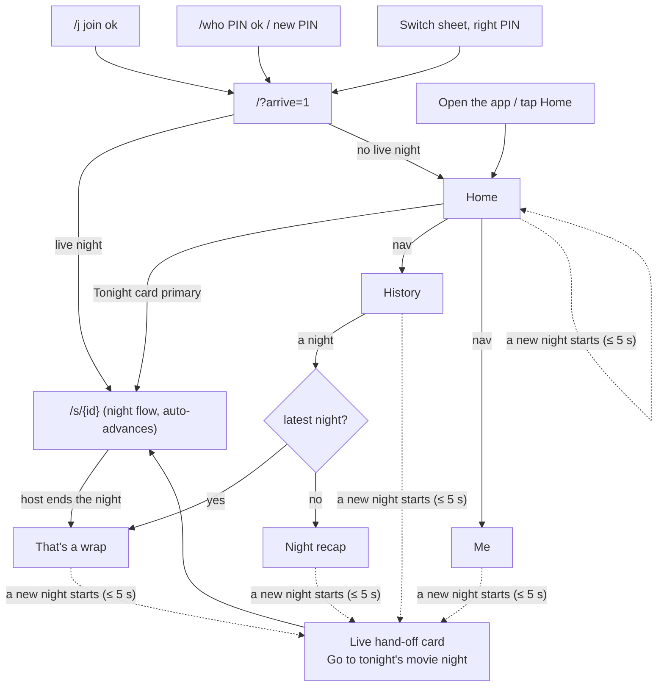

# Proposal: the guest home (a signed-in phone gets a Home, History and Me)

**Status:** Proposal, waiting for the owner's review of the mockups (2026-10-18). Nothing here is
built yet.
**Issue:** #58. Rolls up into #42 (staging finalization and owner sign-off).
**Builds on:** [`guest-flow.md`](guest-flow.md) (the resolver, the screen rules, S0–S14, the switch
sheet and the PIN sheet, all unchanged unless §9 says otherwise),
[`owner-portal.md`](owner-portal.md) (the portal's tab bar and card language, reused so the two
apps feel like one product), [ADR-0004](../decisions/ADR-0004-sse-live-updates.md) (live updates),
[ADR-0008](../decisions/ADR-0008-ctrl-alt-defeat-design-tokens.md) (tokens, one accent, 56px+
targets) and ADR-0014 (person PINs, one current person per phone, PIN on every switch), which this
proposal does **not** change.
**Mockups:** [`guest-home-mockups.html`](guest-home-mockups.html), published at https://claude.ai/artifact/NkfKdSr6U1RdH3x7kFW69P (clickable, 360px: Home in every
Tonight state, the live hand-off, History, a past night, That's a wrap, Me, the switch sheet),
also published as an Artifact linked from the PR.

---

## 1. Executive summary

The owner tested staging on 2026-10-18 and got stuck: *"once a movie is over I'm on a 'That's a
wrap' page and a past movie night, but I just started another movie night and the guest can't get
to it."* They asked for *"a home page where they can navigate"* and a way to *"see the history and
their past movie nights"*.

The guest-flow resolver (`/`) solved getting **into** a night. It never gave the phone a place to
**be** between nights. `/` is a router, not a page: with a live night it redirects away at once,
so the phone has no front page while a night runs, and once inside `/s/[id]` the only screen that
watches for a new night is the one the phone just left. That's the dead end.

This proposal gives a signed-in phone three places, joined by a light bottom nav:

1. **Home** (`/`): a big **Tonight** card with exactly one primary action that follows the night
   (*Open movie night*, *Vote now*, *See the winner*, *Add photos*, *Rate it*). The card watches the
   household's nights, so **a newly started night appears on it within 5 s**, with a "Just started"
   chip and a buzz. Under it: *My recent nights* and the latest family photos.
2. **History** (`/history`): **Mine** (what I picked, whether my pick won, what I rated, my photos)
   and **Family** (every night's winner, turnout, family rating, album).
3. **Me** (`/me`): my picture and name, my stats, change my PIN, and **Switch person** (the existing
   switch sheet, PIN on every switch).

Every past-night screen, including **That's a wrap**, gets the nav and a **live hand-off card**:
when another night is running, the card says so and its **Go to tonight's movie night** button
becomes the screen's one primary action. No screen in the signed-in app can strand the phone again.

The phone still jumps straight into the night at the moments it always did (after joining, after
a right PIN, after a switch), so the guest-flow 30-second budget holds. What changes is that a
returning phone opens on Home, one tap from the ballot, instead of being redirected (§3.3).

Everything ships on **existing endpoints**. Four backend items would make it better, none block it
(§8): a self-service picture change (**G10**, the only one the owner will see missing), a household
"home" read (**G11**), a household live channel (**G12**) and `photo_count` on the night summary
(**G13**, the same as owner-portal O1).

---

## 2. Findings (code survey, 2026-10-18)

| # | Where | What the guest meets | Why it hurts |
|---|---|---|---|
| F1 | `s/[session]/night-screen.tsx` | The `closed` branch is "That's a wrap" with the rating, results, album and a **Past movie nights** button. It runs `useLiveSession(sessionId)` for **this** night only. | When the host starts a new night, nothing on this screen learns about it: the old night's stream publishes nothing more, and the household's live-night query (`useLiveNight`) isn't mounted here. **This is the staging bug.** |
| F2 | `history/history-list.tsx` | Every history row links to `/s/{id}`. | A past night opens the same live-night screen, so History leads back into F1, a "That's a wrap" for a night from last month, with "Voting as RooDog · Switch" on it. |
| F3 | `home-resolver.tsx` | `/` redirects to `/s/{id}` whenever a night is live. The S8 "No movie night yet" screen is the only thing at `/`. | The phone has no home while a night runs. Tapping "home" (if there were such a link) would bounce straight back into the night. |
| F4 | `/me`, `/history`, `/people/[id]`, `/albums/[session]` | Plain `PhoneScreen` pages with no header link and no nav. | Each is a dead end that only the browser's back button leaves. A phone that opened `/history` from a fresh tab has no way anywhere. |
| F5 | `me/my-profile.tsx` | Profile, stats, *Change my name* (once), *Change my PIN*. | No way to change your picture, and no way to switch person except from a night screen's chip. |
| F6 | `components/night/rate-prompt-card.tsx` | "How was *Movie*?" only appears on S8. | A guest who's never on S8 (a night is always live on party weekends) is never asked. |
| F7 | `CurrentChip` | "Voting as **RooDog** · Switch" on every night screen, including `closed`. | It says "voting" on screens where nobody votes. |

What works and stays: the resolver's who/PIN/switch logic (`lib/who.ts`), `useLiveSession`'s SSE
with poll fallback, the switch sheet and PIN sheet, the profile endpoint (which already carries
picks, picked-the-winner, rating and photo count per night), `RatingPanel`, `PhotoAlbum`.

---

## 3. The model: a home with a live window into tonight

### 3.1 Three places, one bar

```
┌──────────────────────────────┐
│ The Baez Family   (🦊 RooDog ▾)│  ← app bar: household, current person (opens the switch sheet)
├──────────────────────────────┤
│                              │
│   page content               │
│                              │
├──────────────────────────────┤
│  ⌂ Home   ☰ History   ☺ Me   │  ← bottom nav, 56px + safe area
└──────────────────────────────┘
```

The **app bar** and **bottom nav** wrap Home, History, Me, a person's profile, an album, and past
nights (That's a wrap and the recap). They do **not** wrap the join and pick-a-person flow (`/j`,
`/who`, the PIN sheet), which stays the full-screen guest-flow design, or the **ballot** (S10),
whose sticky **Done** owns the bottom of the screen. The other live-night screens (S9, S11, S12,
S13) get the nav too, with Home marked by a live dot, so nobody is ever more than one tap from
Home. The ballot gets a **‹ Home** link in its header instead.

### 3.2 Routes

| URL | Today | Becomes | `data-screen` |
|---|---|---|---|
| `/` | Resolver: redirect to `/who` or `/s/{id}`, else S8 | **Home** for a current person. Still S0/S1 for no device and `/who` for no current person (resolver rules unchanged). | `home` |
| `/history` | One list, links to `/s/{id}` | **History**, tabs **Mine** (`?tab=mine`, default) and **Family** (`?tab=family`) | `history` |
| `/s/[id]` (draft…tonight) | Live night | Unchanged, plus the nav (not on the ballot) | as guest-flow |
| `/s/[id]` (closed, the household's latest night) | "That's a wrap" | **That's a wrap**, with the nav and the live hand-off | `wrap` |
| `/s/[id]` (closed, an older night) | "That's a wrap" | **Night recap**: a read-mostly page for a past night | `recap` |
| `/me` | Profile + rename + PIN | **Me** | `me` |
| `/people/[id]` | Profile | Same page, with the shell; reached from Family history and Here tonight | `profile` |
| `/albums/[session]` | Album | Same page, with the shell and a back link to the night | `album` |

No URL is removed, so links already on phones and in the e2e suite keep resolving.

### 3.3 When the phone moves by itself

The guest-flow rule "the resolver is the only place that navigates" becomes two rules:

1. **Arrivals jump into the night.** After a successful join (`/j`), a right PIN or a new PIN
   (`/who`), or a switch, the phone goes to `/?arrive=1`. Home sees `arrive=1`, and if a night is
   live it replaces itself with `/s/{id}`; otherwise it strips the parameter and stays. That keeps
   the guest-flow 30-second path and AC-3.3/AC-7.1 exactly as they are.
2. **Everything else updates in place.** Home never redirects away on its own. A new night, or a
   status change, changes the **Tonight card** (and the live hand-off card on past-night screens)
   within the cadences in §6, with a short vibration (`navigator.vibrate(40)`, where supported) and
   an `aria-live="polite"` announcement. Inside a night (`/s/[id]`, S9→S10→S11→S12→S13), the
   existing auto-advance is unchanged: that is the night's own flow, and the guest chose it.

The cost: a returning phone that opens the app while voting is open lands on Home, and **Vote now**
is one tap. That adds about 1 s to guest-flow §6's 12 s returning-phone column (≈ 13 s, still
inside 30 s). Open question 1 (§11) asks the owner whether the phone should instead jump to the
ballot on a cold open while this person hasn't voted.



### 3.4 What "live" means here

| Fact | Source | Freshness |
|---|---|---|
| **The household's live night** (id, status) | `GET /sessions?status=draft&status=voting&status=revealed&status=tonight&limit=1` (`useLiveNight`, already built) | 5 s poll while the page is visible, refetch on focus and on wake. Mounted in the **shell**, so every signed-in screen has it (fixes F1). |
| **That night's details** (status, options, results) | `useLiveSession(id)`, SSE with poll fallback (ADR-0004) | Instant while the stream is up. Mounted on Home only when a night is live. |
| **Whether this person has voted** | `GET /sessions/{id}/ballots/mine` | Refetched on every stream event (keyed under the night). |
| **What's new** | `sessionStorage["fnh.seenNight"]`: the last live-night id this tab has shown | A live night whose id differs from it is **new**: the card shows the "Just started" chip until the guest opens it or 10 minutes pass. |

There is no household-level stream today, so **discovering** a new night is the 5 s poll; **following**
it, once known, is SSE. G12 (§8) proposes the household channel that would make discovery instant.

---

## 4. Screen rules

All of guest-flow §4 applies (one filled primary marked `data-testid="primary-action"`, the
`secondary` variant for standalone secondary actions, 56px targets, `data-screen` on every root, no
dead ends, live not refreshed). This proposal adds:

1. **Two kinds of screen.** *Task screens* (Home, That's a wrap, every live-night screen) have
   exactly one primary or one announced `waiting` state, as before. *Browse screens* (History, Night
   recap, Me, a profile, an album) have **at most one** primary, and it is the live hand-off card's
   button when a night is running. Without a live night they have none: the nav is the way on.
2. **The nav is never the primary.** Tabs are links styled as nav (icon + label, no cinema fill).
   The active tab has `aria-current="page"`. A live dot on **Home** (cinema colour, with
   `aria-label="Movie night is on"`) shows while a night is live; it says *something is happening*,
   not *you must act*.
3. **The live hand-off is the same component everywhere** (`data-testid="live-handoff"`), at the
   top of the content, under the app bar. It never covers content and is never dismissable while
   the night needs this person (voting open and they haven't voted); otherwise it has a ✕ that hides
   it for that night in this tab.
4. **The primary sits above the nav.** A sticky primary (the ballot's Done, a long recap) is placed
   at `bottom: nav height + 12px`; the last content row scrolls fully above both.
5. **Copy says "movie night", never "session"**, and never "device", "binding" or "profile"
   (guest-flow §7). The bar reads the household name, falling back to "Family Night" when the
   phone doesn't know it (G11).

---

## 5. Screen-by-screen spec

Copy is in §7, keyed by `copy.h.*`.

### H0 — The shell (app bar, bottom nav, live hand-off)

- **App bar** (`header`, 56px): household name on the left (`copy.h.bar.fallback` when unknown);
  on the right the current person's avatar and name as a button, `copy.h.bar.switch` as its
  accessible name, opening the **switch sheet** (guest-flow §5, unchanged: PIN on every switch,
  wrong PIN never changes the current person). On browse screens below Home, a **‹** back link sits
  before the household name (History ‹ Home, recap ‹ History, album ‹ the night).
- **Bottom nav** (`nav aria-label="Main"`, `data-testid="bottom-nav"`): Home, History, Me. 56px tall
  plus `env(safe-area-inset-bottom)`. Hidden on `/j`, `/who`, the PIN sheet and the ballot.
- **Live hand-off** (H0h): shows on every shell screen **except Home** (Home has the Tonight card)
  and **except the live night's own screens**, whenever the household has a live night. One row:
  the night's poster (or the clapperboard while `draft`), `copy.h.handoff.<status>` and a full-width
  button `copy.h.handoff.go` (→ `/s/{id}`). On browse screens it is the one primary; on That's a
  wrap it replaces the rating as the primary (H3w).

### H1 — Home (`/`, `data-screen="home"`)

Top to bottom:

1. **Greeting**: `copy.h.home.hi` ("Hi, **RooDog**") in the heading size, no lede.
2. **Tonight card** (`data-testid="tonight-card"`, `data-state="<T-id>"`): the one primary on the
   screen. It follows the household's live night and, for `voting`, whether this person (and the
   others on this phone) voted.
3. **How was *Movie*?** (the existing `RatePromptCard`) only when the Tonight card isn't already
   asking (T6). Its button is `secondary` here, because the Tonight card owns the primary.
4. **My recent nights**: the newest 3 from `GET /people/{me}/profile`, as compact rows (poster,
   title, date, badges *Your pick won* / *You rated ★4* / *Rate it*), then **See all my nights**
   (→ `/history?tab=mine`, a text link).
5. **Family photos**: a 4-up strip from the latest night that has photos (`GET /sessions/{id}/photos`
   for the newest `tonight`/`closed` night), tapping → `/albums/{id}`. Hidden when there are none.

**Tonight card states**

| Id | When | Card shows | Primary (`primary-action`) |
|---|---|---|---|
| T0 | No live night, nothing to rate | `copy.h.t0.*`, the clapperboard; `data-testid="waiting"`, `aria-live` | none (waiting). The card updates in place when a night starts. |
| T1 | `draft` | `copy.h.t1.*` with the live count of shortlisted titles; "Just started" chip if new | **Open movie night** → `/s/{id}` (S9) |
| T2 | `voting`, this person hasn't voted | `copy.h.t2.*`, the Here tonight row, "N of M voted"; "Just started" chip if new | **Vote now** → `/s/{id}` (S10) |
| T3 | `voting`, this person voted, someone else on this phone hasn't | `copy.h.t3.*` | **Pass to next person** → opens the switch sheet |
| T4 | `voting`, everyone on this phone voted | `copy.h.t4.*`, live "N of M voted"; `waiting` | none (waiting for the reveal); a `secondary` **Change my picks** |
| T5 | `revealed` | The winner's poster and title, `copy.h.t5.*` | **See the winner** → `/s/{id}` (S12) |
| T6 | `tonight` | Compact winner, `copy.h.t6.*` | **Add photos** → `/s/{id}` (S13); `secondary` **Already watched? Rate it** |
| T7 | No live night, the newest `closed` night isn't rated by this person | `copy.h.t7.*`, the poster | **Rate it** → `/s/{id}#rate` (That's a wrap with the stars open) |

The card never shows T0 while a rating is owed; it shows T7 instead, and the separate
`RatePromptCard` (item 3) is hidden. "Not now" on T7 falls back to T0 for that night (the existing
`dismissRatePrompt`).

**New night hand-off on Home.** When the live-night poll returns an id that isn't
`fnh.seenNight`, the card cross-fades to T1/T2 with the chip `copy.h.new`, the phone vibrates once
and the card's status line announces `copy.h.newAnnounce`. Opening the night (or 10 minutes)
records the id and drops the chip.

**Empty household history.** *My recent nights* shows `copy.h.empty.mine` with no button (the
Tonight card is the action). Family photos is hidden.

### H2 — History (`/history`, `data-screen="history"`, `data-tab="mine|family"`)

A segmented control (`role="tablist"`, two tabs, 48px) under the title. The tab is in the URL
(`?tab=`), so Back and reload keep it.

- **Mine** (default), from `GET /people/{me}/profile` (`nights`, newest first; already returns
  ballots only for nights past the reveal):
  - Row: poster, winner title, date, and up to three facts: **Your picks** (top 3 titles in rank
    order, or "You approved N" for approval), 🏆 **Your pick won** when `picked_winner`,
    ★ **You rated 4** or a `secondary` small **Rate it** button when the night is `tonight`/`closed`
    and unrated, 📷 **N photos** (→ the album).
  - Above the list, a one-line summary from `stats`: `copy.h.hist.mineSummary`.
  - Empty: `copy.h.empty.mine`.
- **Family**, from `GET /sessions` (the existing history list, default filter):
  - Row: poster, winner, date, `{turnout} voted`, ★ family average, 📷 count (needs G13; hidden
    until then).
  - Empty: `copy.h.empty.family`.
- Tapping a row → `/s/{id}`, which renders That's a wrap or the recap (H3).
- **Primary:** none, except the live hand-off.

### H3 — Past nights (`/s/[id]` when `closed`)

The night screen's `closed` branch splits by whether this is the household's **latest** night
(the newest of `GET /sessions?limit=1` across all statuses, which the shell already has from the
live-night poll's sibling query; see §6).

#### H3w — That's a wrap (`data-screen="wrap"`, the latest night, just ended)

Top to bottom: the live hand-off (when a newer night is running), the compact winner card,
**How was *Movie*?** stars (`RatingPanel`), the family results (collapsed, **See all results**),
the album with **Add photos** (`secondary`), the nav.

| Situation | Primary |
|---|---|
| A newer night is live | The hand-off's **Go to tonight's movie night** |
| No live night, this person hasn't rated | The star row (as S14) |
| No live night, rated | **Back to Home** (`copy.h.wrap.home`) |

The `CurrentChip` is replaced by the app bar (F7). **Past movie nights** is gone: History is in the
nav.

#### H3r — Night recap (`data-screen="recap"`, an older night)

A browse screen for remembering a night: the date and title as the heading, the winner card,
**Your night** (my picks with the winner marked, my rating as stars, editable while ratings are
open), **The family's picks** (results, expanded), **Who came** (Here tonight row for that night,
from `/present`), and the album grid with **See all photos** (→ `/albums/{id}`). Primary: none,
except the live hand-off.

### H4 — Me (`/me`, `data-screen="me"`)

1. **Header**: the avatar (96px) with a small **Change picture** button over its corner (needs
   G10; hidden until it ships), the name, `copy.h.me.since` ("Family since March 2026" or "Guest
   since…").
2. **Change my name** (`secondary`, once, while `can_rename`, as built) with `copy.h.me.renameHelp`.
3. **Stats** (2×2 from `profileStats`): nights, winners picked, average rating given, photos.
   **See my nights** → `/history?tab=mine`.
4. **This phone** section:
   - **Switch person** (`secondary`) → the switch sheet (PIN on every switch, ADR-0014).
   - **Add someone to this phone** (text link) → `/who`.
   - A quiet line `copy.h.me.shared` listing the others this phone holds, when there are any.
5. **Change my PIN** (`secondary`, as built: current PIN, new PIN, again).
6. Footer: `copy.common.hostSignIn` (text link).

Primary: none, except the live hand-off. **Change picture** (G10) opens a sheet with the 8
`GUEST_EMOJI` plus the avatar colours; tapping saves immediately and closes the sheet.

### H5 — A person's profile (`/people/[id]`, `data-screen="profile"`)

Unchanged content (stats, nights, albums), inside the shell with **‹** back. Reached from a Family
history row's turnout avatars, from Here tonight on a recap, and from Me's *This phone* line.
Your own id redirects to `/me`.

### H6 — Album (`/albums/[session]`, `data-screen="album"`)

Unchanged content, inside the shell with **‹** back to the night (`/s/{id}`). The "Pick who you are
to add photos" link goes through `/` (as guest-flow §5 S13 says).

### Live-night screens (S9–S13) changes

- S9, S11, S12, S13 render inside the shell (app bar + nav, Home with the live dot). The night's own
  `CurrentChip` stays only on S10 and S11 ("Voting as **RooDog** · Switch"), where voting is the
  point; elsewhere the app bar's person button does the same job.
- S10 (ballot): no nav; the header gains **‹ Home**. Leaving keeps unsaved picks in memory for this
  tab (`sessionStorage`, keyed by night and person) so coming back restores them.
- No other behaviour changes.

---

## 6. Data flow

| Query (key) | Endpoint | Where mounted | Cadence |
|---|---|---|---|
| `["people"]` | `GET /people` | Shell | As today (`waitingPollInterval`), refetch on focus |
| `["nights","live"]` | `GET /sessions?status=draft…tonight&limit=1` | **Shell** (was: `/` and `/who` only) | 5 s while visible, on focus, on wake |
| `["nights","latest"]` | `GET /sessions?status=draft…closed&limit=1` | Shell, only while on `/s/[id]` closed | 30 s, on focus. Decides H3w vs H3r. |
| `nightKey(id)` | `useLiveSession(id)` | Home (T1–T6), the night screens | SSE, poll fallback |
| `[...nightKey(id), "ballots"]` | `GET /sessions/{id}/ballots/mine` | Home in `voting` | On every stream event |
| `profileKey(me)` | `GET /people/{me}/profile` | Home (recent nights), History Mine, Me | On focus; invalidated after a rating, photo upload or rename |
| `["nights","history"]` | `GET /sessions` | History Family | On focus |
| `["nights","rate-prompt"]` | `GET /sessions?status=tonight&status=closed&limit=1` | Home | As built |

`useLiveNight` moves from the resolver into a `useHouseholdNight()` hook used by the shell. It
returns `{ night, isNew, markSeen }`; `isNew` compares against `fnh.seenNight` in `sessionStorage`
(guarded with try/catch, like `night-code-handoff.ts`). The poll pauses while the page is hidden
(`refetchIntervalInBackground: false`, TanStack's default) and resumes on `visibilitychange`, so a
pocketed phone costs nothing. At household scale (≤ 10 phones × one request per 5 s while
foregrounded) this matches the cost guest-flow already accepted for S8.

Home's request count on a cold open: `people`, `nights/live`, `profile`, `rate-prompt`, one photos
read, plus `session` and `ballots` when a night is live: 5–7 small reads, in parallel. G11 folds
them into one.

---

## 7. Copy deck

Rules as guest-flow §7: second person, short sentences, no jargon, no blame; names in **bold**.

| Id | Text |
|---|---|
| `copy.h.bar.fallback` | Family Night |
| `copy.h.bar.switch` | Switch person (now **{name}**) |
| `copy.h.nav.home` / `.history` / `.me` | Home / History / Me |
| `copy.h.nav.live` | Movie night is on |
| `copy.h.home.hi` | Hi, **{name}** |
| `copy.h.new` | Just started |
| `copy.h.newAnnounce` | A new movie night just started. |
| `copy.h.t0.title` | No movie night yet |
| `copy.h.t0.body` | When the host starts one, it shows up right here. |
| `copy.h.t1.title` | Movie night is starting |
| `copy.h.t1.body` | The host is picking movies ({n} so far). |
| `copy.h.t1.button` | Open movie night |
| `copy.h.t2.title` | Voting is open! |
| `copy.h.t2.body` | **{voted} of {total}** voted. Pick your favourites. |
| `copy.h.t2.button` | Vote now |
| `copy.h.t3.title` | Your picks are in |
| `copy.h.t3.body` | **{names}** on this phone still need to vote. |
| `copy.h.t3.button` | Pass to next person |
| `copy.h.t4.title` | Your picks are in |
| `copy.h.t4.body` | **{voted} of {total}** voted. The winner shows up here. |
| `copy.h.t4.change` | Change my picks |
| `copy.h.t5.title` | Tonight's movie is… |
| `copy.h.t5.button` | See the winner |
| `copy.h.t6.title` | Tonight: **{movie}** |
| `copy.h.t6.body` | Snap the couch crew, the snacks, the screen. |
| `copy.h.t6.button` | Add photos |
| `copy.h.t6.rate` | Already watched? Rate it |
| `copy.h.t7.title` | How was **{movie}**? |
| `copy.h.t7.button` | Rate it |
| `copy.h.recent` | My recent nights |
| `copy.h.recent.all` | See all my nights |
| `copy.h.photos` | Family photos from **{movie}** |
| `copy.h.badge.won` | Your pick won |
| `copy.h.badge.rated` | You rated ★{n} |
| `copy.h.badge.rate` | Rate it |
| `copy.h.empty.mine` | Your movie nights will show up here after the first one. |
| `copy.h.empty.family` | No movie nights yet. Tonight could be the first. |
| `copy.h.hist.title` | History |
| `copy.h.hist.mine` / `.family` | Mine / Family |
| `copy.h.hist.mineSummary` | **{nights}** nights · **{won}** winning picks · ★ **{avg}** average |
| `copy.h.hist.picks` | Your picks: {titles} |
| `copy.h.hist.approved` | You liked {n} |
| `copy.h.hist.turnout` | {n} voted |
| `copy.h.handoff.draft` | A new movie night is starting. |
| `copy.h.handoff.voting` | Voting is open for tonight's movie night! |
| `copy.h.handoff.revealed` | Tonight's winner is in. |
| `copy.h.handoff.tonight` | Tonight's movie: **{movie}** |
| `copy.h.handoff.go` | Go to tonight's movie night |
| `copy.h.wrap.title` | That's a wrap |
| `copy.h.wrap.lede` | Thanks for movie night. |
| `copy.h.wrap.home` | Back to Home |
| `copy.h.recap.yours` | Your night |
| `copy.h.recap.family` | The family's picks |
| `copy.h.recap.who` | Who came |
| `copy.h.recap.photos` | See all photos |
| `copy.h.me.since` | {Family\|Guest} since {month year} |
| `copy.h.me.picture` | Change picture |
| `copy.h.me.renameHelp` | You can change your name once. After that, ask the family admin. |
| `copy.h.me.phone` | This phone |
| `copy.h.me.switch` | Switch person |
| `copy.h.me.add` | Add someone to this phone |
| `copy.h.me.shared` | Also on this phone: {names} |
| `copy.h.me.pin` | Change my PIN |
| `copy.h.me.myNights` | See my nights |

Unchanged and reused: `copy.common.hostSignIn`, the switch-sheet and PIN-sheet copy, `copy.chip`,
`copy.here.*`, `copy.s13.*`, `copy.s14.title`.

---

## 8. Backend gaps

Numbered after guest-flow's G1–G9. None blocks the build; each row says what ships without it.

| # | Priority | Gap | Proposal | Without it |
|---|---|---|---|---|
| **G10** | P1 | A person can't change their own picture. `PATCH /devices/me/people/{id}` takes `RenameSelfIn` (`name` only) and the rename-once rule applies. | Accept `avatar_emoji` and `color` on the same route (each optional, at least one field), for the **current** person only. Picture changes are **not** limited to once; the rename-once counter only moves when `name` changes. Audit `person.avatar_changed`. Same validation as self-create (`GUEST_EMOJI`-sized emoji, colour from the palette). | **Change picture** is hidden on Me. |
| **G11** | P2 | Home composes 5–7 reads, and a device can't learn its household's name (only `fnh.lastJoin`, written on a join in this browser, has it). | `GET /devices/me/home` → `{household_name, current_person_id, live_night: {id, status, voted: bool} \| null, latest_night_id, rate_owed: {session_id, title} \| null}`. Supersedes guest-flow's G7. | The bar falls back to `copy.h.bar.fallback`; Home makes its parallel reads. |
| **G12** | P2 | No household-level live channel, so a new night is discovered by the 5 s poll (§3.4). Claims, approvals and resets publish nothing either (guest-flow G5). | A household SSE channel (ticket scoped to the device's household) publishing `night.created` and `night.status` (ids and status only, after commit). One more ADR-0004 channel; the client subscribes in the shell and invalidates `["nights","live"]`. | The 5 s visible-only poll. Measured cost is a few requests per minute per foregrounded phone. |
| **G13** | P2 | `NightSummaryOut` has no `photo_count`. This is owner-portal **O1**; one change serves both. | `photo_count: int` (visible, completed photos) via one grouped subquery. | The 📷 count on Family history rows is hidden. |

Checked, no gap: the profile endpoint already returns per-night picks (rank order), `picked_winner`,
`rating` and `photo_count`, and stats; `GET /sessions/{id}/present` exists for Who came; ratings are
open on `closed` nights, so the recap's stars are editable; `ballots/mine` answers "did I vote".

---

## 9. Where this changes guest-flow

| # | Guest-flow today | Changes to |
|---|---|---|
| D14 | `/` is a resolver that redirects to the live night; S8 is the only page there. | `/` is Home. Resolver rules for no device / no current person are unchanged; a live night is shown on the Tonight card instead of redirected to, except on arrival (`?arrive=1`, §3.3). S8 becomes Tonight state T0. |
| D15 | Join, PIN success and switch go to `/`. | They go to `/?arrive=1`. |
| D16 | "That's a wrap" (`closed`) is one screen for every past night, with **Past movie nights** and `CurrentChip`. | H3w for the latest night (with the hand-off), H3r for older nights; both in the shell; no chip. |
| D17 | History rows have no "mine" view; `/me` shows the nights list. | History has Mine and Family; Me keeps stats and settings and links to Mine. |
| D18 | `RatePromptCard` appears on S8 only. | Home shows T7 or the card; Mine rows offer **Rate it**. |
| D19 | No nav anywhere on the phone. | App bar + bottom nav on Home, History, Me, profiles, albums, past nights and S9/S11–S13. |

Acceptance criteria superseded (any spec asserting the old behaviour changes in piece F, §10):

| Guest-flow AC | Was | Now |
|---|---|---|
| AC-2.3 | `/` with a current person never shows `screen(who)` | Unchanged, and it shows `screen(home)`. |
| AC-9.1 | No live night → `screen(no-night)`; creating a night → `screen(almost-ready)` within 7 s | No live night → `screen(home)` with `tonight-card[data-state=T0]`; creating a night → `data-state=T1` within 7 s, **without** leaving Home. |
| AC-1.5, AC-3.3, AC-7.1 | Land on the resolver's / the night screen | Unchanged (arrivals jump, §3.3). |

---

## 10. Build plan and file ownership

The build waits for the e2e sign-off PR (it edits `(public)/who` and `frontend/e2e`). The split
below gives every file one owner. Piece **A** lands first (small, shared plumbing); **B**, **C**,
**D** and **E** then run in parallel. The full briefs are in
[`guest-home-build-split.md`](guest-home-build-split.md).

| Piece | Owns | Delivers |
|---|---|---|
| **A — Shell + live hand-off** (first) | new `src/lib/home.ts` (+test), new `src/hooks/use-household-night.ts`, new `src/components/home/{app-bar,bottom-nav,live-handoff,guest-shell}.tsx`, `src/hooks/use-phone.ts`, `docs/architecture/04-frontend.md` | `tonightState()`, `isNewNight()`, `arrivalTarget()`, `pastNightKind()`; the shell; the hand-off; §3.3 rule 1 helper. |
| **B — Home** | `src/app/home-resolver.tsx` (→ Home), new `src/components/home/{tonight-card,recent-nights,photo-strip}.tsx`, `src/components/night/rate-prompt-card.tsx`, `src/app/(public)/who/who-grid.tsx` and `src/app/(public)/j/[slug]/join-form.tsx` (the `?arrive=1` lines only), `src/components/night/switch-sheet.tsx` (arrival line only) | H1, T0–T7, §3.3. |
| **C — Night screens + past nights** | `src/app/(public)/s/[session]/*`, `src/app/(public)/albums/[session]/*` | H3w, H3r, shell on S9/S11–S13, ‹ Home on S10, H6. |
| **D — History + Me + profile** | `src/app/(public)/history/*`, `src/app/(public)/me/*`, `src/app/(public)/people/[id]/*` | H2, H4 (Change picture behind G10), H5. |
| **E — Backend G10** (optional, parallel) | `backend/app/api/v1/people.py`, `backend/app/services/people_service.py`, `backend/app/schemas/identity.py`, their tests, the generated OpenAPI types and an **additive** `src/lib/api.ts` method | Self picture change. D shows the button once E merges. |
| **F — e2e** (last) | `frontend/e2e/guest-home.spec.ts` (new). No existing spec asserts `no-night`/AC-9.1 today (checked 2026-10-18); re-check after the e2e sign-off merges | §12 as Playwright, written but run only by the owner's sign-off pass. |

Tests: Vitest for `home.ts` (100% branches, like `portal.ts`) and the components each piece touches.
No full suite, no Playwright runs, no deploys.

---

## 11. Open questions for the owner

1. **Cold open during voting.** When a returning phone opens the app while voting is open and this
   person hasn't voted, should it land on **Home** (Vote now is one tap; the proposal) or jump
   straight to the **ballot** (guest-flow's behaviour, ≈ 1 s faster)? Either is a one-line rule in
   `arrivalTarget()`.
2. **That's a wrap when a new night starts.** The proposal makes the hand-off card the primary but
   doesn't move the phone. Should That's a wrap instead move to the new night by itself once voting
   opens there?
3. **Picture changes.** Should guests be allowed to change their picture as often as they like (the
   proposal), or once like their name?

---

## 12. Acceptance criteria (Playwright-ready)

Conventions as guest-flow §11: `screen(x)` = `[data-screen="x"]` visible; `primary` =
`getByTestId("primary-action")`; household **The Baez Family**; viewport 360×640. A phone "set to
RooDog" has RooDog current with a PIN.

**Shell**
- AC-H0.1: On `home`, `history`, `me`, `profile`, `album`, `wrap`, `recap`, `almost-ready`,
  `picks-in`, `winner` and `tonight`, `bottom-nav` is visible with exactly three links (Home,
  History, Me), each ≥ 56px tall, and the active one has `aria-current="page"`.
- AC-H0.2: On `join`, `who`, the PIN sheet and `ballot`, `bottom-nav` is absent. `ballot` has a
  link named "Home" in its header.
- AC-H0.3: The app bar's person button opens the switch sheet. Switching to B with B's right PIN →
  `screen(…)` for the live night (arrival); with a wrong PIN → `GET /people` still reports RooDog
  `current`.
- AC-H0.4: No visible text contains "session", "device", "binding" or "profile".

**Home**
- AC-H1.1 (T0): No live night and nothing to rate → `screen(home)`, `tonight-card[data-state=T0]`,
  zero `primary-action`, one `waiting` with an `aria-live` region.
- AC-H1.2 (new night, the staging bug): on `screen(home)` in T0, create a night through the API →
  within 7 s `tonight-card[data-state=T1]` with the "Just started" chip; `page.url()` is still `/`.
  Open voting → within 2 s (stream up) `data-state=T2` and exactly one `primary-action` "Vote now".
- AC-H1.3 (T2→T3/T4): RooDog votes → `data-state=T4` (single-person phone) with "N of M voted"
  updating when another phone votes; on a phone also holding B who hasn't voted → `T3` with primary
  "Pass to next person" opening the switch sheet.
- AC-H1.4 (T5, T6): close voting → `T5` primary "See the winner"; after the settle → `T6` primary
  "Add photos" and a `secondary` "Already watched? Rate it".
- AC-H1.5 (T7): end the night with RooDog unrated → `T7` primary "Rate it" → `screen(wrap)` with the
  stars open. After rating, Home shows T0.
- AC-H1.6: Each Tonight state has exactly one `primary-action` (T0 and T4: zero plus `waiting`).
- AC-H1.7: *My recent nights* shows at most 3 rows from the profile, and **See all my nights** goes
  to `/history?tab=mine`.

**Arrivals**
- AC-H2.1: Join with a live night in `voting` → `screen(ballot)` within 3 s (guest-flow AC-1.2 path
  intact). With no live night → `screen(home)`, and the URL has no `arrive`.
- AC-H2.2: A right PIN on `/who` with a live night → the night screen within 2 s (AC-3.3 intact).
- AC-H2.3: Tapping **Home** from `ballot` → `screen(home)` and the phone stays there for 10 s.

**Past nights and the hand-off**
- AC-H3.1 (the staging bug): on `screen(wrap)` for the latest night, create a new night through the
  API → within 7 s `live-handoff` is visible and is the only `primary-action` ("Go to tonight's
  movie night"); tapping it → that night's screen.
- AC-H3.2: `screen(wrap)` with no live night: unrated → the star row is the primary; rated → "Back
  to Home" is the primary and goes to `screen(home)`.
- AC-H3.3: Opening an older closed night from History → `screen(recap)` with zero `primary-action`
  (no live night), the person's picks with the winner marked, and the album link.
- AC-H3.4: `live-handoff` appears on `history`, `me`, `recap`, `profile` and `album` whenever a night
  is live, and never on `home` or that night's own screens.

**History**
- AC-H4.1: `/history` opens on **Mine** (`data-tab=mine`); rows show the person's picks in rank
  order, "Your pick won" exactly when the profile says `picked_winner`, and "You rated ★n" or a
  **Rate it** button.
- AC-H4.2: **Family** (`?tab=family`) lists every night from `GET /sessions` with turnout; reload
  keeps the tab.
- AC-H4.3: Empty household → `copy.h.empty.mine` / `copy.h.empty.family`, and the nav is the only way
  on (no dead end).

**Me**
- AC-H5.1: `screen(me)` shows the avatar, name, stats, **Switch person**, **Change my PIN**, and
  **Change my name** only while `can_rename`.
- AC-H5.2: **Switch person** opens the switch sheet; every switch asks for a PIN (guest-flow AC-8.3
  on this entry point).
- AC-H5.3 (with G10): **Change picture** → pick 🐙 → one `PATCH /devices/me/people/{id}` with
  `avatar_emoji` → the app bar and Me show 🐙; `can_rename` is unchanged.
- AC-H5.4: `/people/{own id}` redirects to `/me`.
