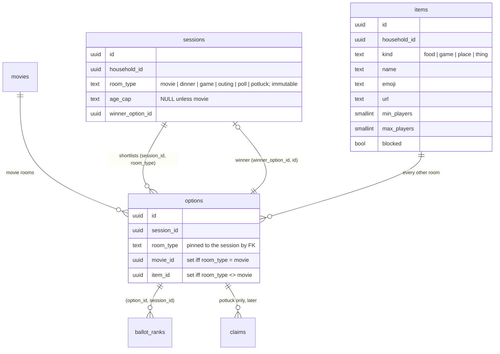
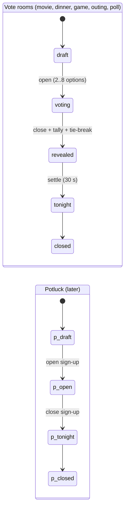

# Proposal — Other room types (Phase 3+)

**Status:** Proposal for the owner's decision (2026-10-15). Nothing here is built.
**Decision record:** [ADR-0011](../decisions/ADR-0011-room-types-generalisation.md) (Proposed).
**Scope note:** BUILD-PROMPT.md defers "other room types" to Phase 3+. This document sizes them;
it does not change that ordering.

## Executive summary

Most of Family Night Hub is already room-agnostic: the night lifecycle, night code + QR join,
avatars, the tally engine, hidden tallies and the seeded tie-break, SSE live updates, the photo
album, ratings and history all key on `session_id` and `option_id`, never on a movie. The
movie-specific surface is narrow: `options.movie_id NOT NULL` (with its composite FK to
`movies`), TMDB, the generator, the age cap, posters, and the copy. **Build a dinner / takeout vote
first**: it happens weekly, reuses the night + voting + photos + ratings engine unchanged, needs
no external API, and forces exactly the one schema change every later room needs. Generalise with
**option (a), refined**: one `sessions` table with an immutable `room_type`, one `options` table
whose rows reference exactly one catalog row (`movies` for movie rooms, a new household `items`
catalog for everything else), with the room type pinned to the session by a composite FK so the
database, not the service, guarantees a dinner night can't hold a movie. Ballots, the winner FK,
the tally and the property tests do not change. The migration is purely additive (expand only;
there is nothing to contract). Game-night pick and an outing vote then cost a small slice each;
potluck is the first room that is not a vote and should wait until a vote room has shipped.
**Do not build chore or allowance draws.**

| # | Room type | Value for this family | Engine reuse | New surface | Effort | Verdict |
|---|---|---|---|---|---|---|
| 1 | Dinner / takeout vote | High (weekly) | High | `items` catalog, item picker, copy | S–M | **Build first** |
| 2 | Game-night pick (link to CAD) | Medium–High | High | `game` items with player counts, CAD link | S | Build second |
| 3 | Outing / day-trip vote | Medium (monthly) | High (vote) / Low (date poll) | `place` items with a URL; date poll later | S (vote) / L (dates) | Build the vote only |
| 4 | Potluck / sign-up | Medium (holidays) | Medium (no tally) | `claims` table, non-voting lifecycle | M | Later, after 1–3 |
| 5 | Show / season picker | Medium | Very high (TMDB) | TMDB TV endpoints, TV ratings ≠ film certs | M | Maybe; movie-room variant |
| 6 | Family book club | Low–Medium (kids' ages) | Medium | Multi-week lifecycle, book source | M | Not now |
| 7 | Quick vote (anything) | Medium | Very high | Nothing beyond slice 1 | XS | Free with slice 1 |
| 8 | Chore / allowance draws | Contested | Low–Medium | Recurrence, assignment, money ledger | M–L | **Don't build** |

---

## 1. What a "room" is today

A "room" is a **night**: one `sessions` row and everything hanging off it. Reading the schema
(`backend/migrations/versions/0001_phase1_core.py`) and the domain code, the split is:

### Already generic (reuse as is)

| Piece | Where | Why it's generic |
|---|---|---|
| Lifecycle `draft → voting → revealed → tonight → closed` | `domain/session_state.py` | Pure transitions over a status string; the only movie words are in error messages |
| Night code + QR join, device tokens, avatars | `domain/night_code.py`, `join_service`, ADR-0002 | Resolves a session id and a person; never looks at options |
| Shortlist rules (2–8 options, `k = min(3, n − 1)`, frozen on open) | `session_state.py` | Counts option rows, nothing else |
| Tally + tie-break + seed | `domain/voting/` (ADR-0006) | `tally(options: Sequence[str], ballots, seed)` takes **option ids only** |
| Ballots | `ballot_ranks` | References `option_id` via composite FK `(option_id, session_id) → options(id, session_id)` |
| Winner | `sessions.winner_option_id` | Composite FK `(winner_option_id, id) → options(id, session_id)` |
| Hidden tallies, turnout tiles | `shows_result`, live snapshot | Status-driven |
| Live updates | `live_service`, SSE `session:{id}` (ADR-0004) | Hints say "refetch"; the snapshot carries the data |
| Photo album + reactions | `photos`, `photo_service`, keys `households/{hid}/sessions/{sid}/…` (ADR-0005) | Keyed by session; gated on effective status `tonight`/`closed` |
| Ratings | `ratings (session_id, person_id, score)` | Rates the **night**, not a movie; the per-movie average is derived through the winner |
| History, audit | `sessions` queries, `audit_events` | Session-shaped |

### Movie-specific (must be generalised or kept movie-only)

| Piece | Where | Treatment |
|---|---|---|
| `options.movie_id NOT NULL` + FK `(movie_id, household_id) → movies` + `unique(session_id, movie_id)` | migration 0001 | **The one structural blocker.** Relax to "exactly one of `movie_id`, `item_id`" |
| `options.source IN (manual, owned, streaming, tmdb)` | migration 0001 | Movie provenance; `manual` covers typed items too |
| `movies` library, TMDB client + cache | `movie_service`, `integrations/tmdb.py` | Stays movie-only |
| Generator (owned → streaming → TMDB) | `domain/generator.py`, ADR-0007 | Stays movie-only. A catalog "pick for me" is a separate, much smaller rule set |
| `sessions.age_cap` (US film certification) | migration 0001, ADR-0007 | Movie-only; `NULL` for other rooms (CHECK) |
| `OptionView`/`Winner` shape: `movie_id, title, year, poster_path` | `session_service.py`, `api/v1/sessions.py`, OpenAPI | Additive fields; `title` becomes the universal display name |
| Per-movie rating average (generator "rescue") | `rating_service` joins `options.movie_id` | Movie-only; items get the same query on `item_id` |
| UI: `movie-search.tsx`, posters in `voting-flow`, `winner`, TV `reveal`, `history-list` | frontend | Per-kind option card + picker |
| Copy: "tonight's movie", "movie night" | services + frontend | Per-room copy table |

The conclusion that drives everything below: **the vote, the reveal and the album never needed to
know what an option is.** Only the shortlist row's reference and its presentation do.

## 2. Candidate room types

Scoring: *value* is for this family (frequency × how much friction it removes); *reuse* is of the
night + voting + photos engine; *effort* is S ≈ one focused PR, M ≈ 2–3 PRs, L ≈ a phase.

### 2.1 Dinner / takeout vote — **recommended first**

"Thai, pizza or the taco place?" is the most frequent family decision, and it has the same shape
as movie night: a short list, everyone weighs in, one answer, done in two minutes.

- **Reuse:** High. Lifecycle, join, ballots, tally, reveal, TV, ratings ("how was it?") all
  unchanged. Photos optional but natural (birthday dinners).
- **New data:** an `items` catalog row per place/meal (name, emoji, optional URL, `blocked`), so
  "the taco place" is the same row every week, which history, ratings and "not the same as last
  time" need. Typed options auto-create an item, exactly as typed movie titles already
  auto-create a `movies` row (`movie_service.upsert_manual`).
- **New UI:** an item picker in the host builder (recent + typed), an emoji/name option card,
  reveal and history cards without a poster.
- **Risks:** low. No external API, no new personal data. The kid-dynamics risk (bandwagoning) is
  already handled by hidden tallies.
- **Effort:** S–M (the schema expand is the M part, and it is paid once for every later room).
- **Voting method:** pick-one or approval often suits dinner better than top-3; that rides on the
  parallel voting-methods work (ADR-0010) as a per-room default, not on this proposal.

### 2.2 Game-night pick — link to Ctrl+Alt+Defeat

Pick *which* board or video game to play. 01-system-context.md is explicit: "No game-night
scoreboard: that already exists as Ctrl+Alt+Defeat, so link to it."

- **Reuse:** High; identical to dinner with `game` items.
- **New data:** `game` items carry `min_players`/`max_players` (and optionally a play time). The
  host builder warns when tonight's joined headcount is outside a game's range; it is a filter
  like the movie runtime cap, not a new mechanism.
- **CAD boundary:** the reveal and the `tonight` screen show a **link** to CAD (a
  household setting holding the CAD URL). No shared auth, no score sync, no data sent to CAD.
  Scores, belts and leagues stay in CAD.
- **Risks:** low. The temptation is scope creep into scoring; the ADR makes "link only" explicit.
- **Effort:** S once dinner has shipped.

### 2.3 Outing / day-trip planner

Two different problems hide here: **where** (a vote, cheap) and **when** (an availability poll, a
new interaction: a person × date grid, not a ranking).

- **Reuse:** High for the destination vote; low for the date poll.
- **New data:** `place` items with a URL (a maps link the host pastes; no maps API). A
  `sessions.planned_for date` column is optional and display-only.
- **Lifecycle fit:** an outing chosen on Monday for Saturday sits in `tonight` for days. That
  works today (codes are unique only among non-closed nights; photos stay open after close), but
  the copy must stop saying "tonight", and the host needs to close it.
- **Risks:** places are stored as names + links the family typed; no geolocation, and photos
  already keep only `taken_at` (EXIF location is never stored, ADR-0005). The trip album is the
  most valuable album the app will hold, which raises the stakes on the existing
  no-public-sharing rule, not lowers them.
- **Effort:** S for the destination vote; L for a real date poll. **Build the vote; defer dates.**

### 2.4 Potluck / sign-up ("who brings what")

The first room that is **not a vote**: people *claim* slots. Most valuable for holidays with
extended family as guests.

- **Reuse:** Medium. Join, guests, avatars, SSE, photos, history: yes. Ballots, tally and reveal:
  no. The shortlist becomes the slot list ("dessert", "drinks", "a side"), so `options` still
  works as the slot table.
- **New data:** `claims (session_id, option_id, person_id, note)` with the composite FK
  `(option_id, session_id) → options(id, session_id)` (same pattern as ballots) and a capacity
  rule (one claimant per slot by default, enforced by a unique index).
- **New lifecycle:** `draft → open (claiming) → tonight → closed`; no `revealed`. This is the
  forcing function for a per-room lifecycle policy (section 4).
- **Risks:** guests see each other's names and what they bring; that is the point, and they are
  already household guests for the night. Low.
- **Effort:** M. Do it after at least one non-movie vote room has proved the generalisation.

### 2.5 Show / season picker

"Which series do we start next?" The closest relative of movie night.

- **Reuse:** Very high, including TMDB (search, posters).
- **New data:** TMDB TV ids live in a different id space from movie ids, so `movies` would need a
  `media_type` (or a sibling `shows` table). TV content ratings (`TV-Y7`, `TV-PG`, `TV-14`) are not
  the film certifications the age cap uses, so the age cap needs a mapping, and it should be
  tested as carefully as the film one.
- **Value:** medium; a series is chosen far less often than a film.
- **Effort:** M. Treat it as a movie-room variant, not a new room type.

### 2.6 Family book club

Vote on the next book, then meet weeks later to talk about it.

- **Reuse:** Medium. The vote is the same; the lifecycle spans weeks and the "night" is the
  discussion, not the pick.
- **New data:** book items (Open Library has a free API; or typed titles). A "reading" phase.
- **Value:** depends on the kids' ages; low today unless the owner says otherwise.
- **Effort:** M. **Not now.**

### 2.7 Quick vote (anything)

"Pancakes or waffles?" A room with typed options and nothing else.

- **Reuse:** Very high.
- **New:** nothing beyond the dinner slice: it *is* the dinner room with a generic `item` kind and
  neutral copy.
- **Risk:** it competes with a group chat; its only edge is the TV reveal and the avatars. Ship it
  because it is free, not as a headline feature.
- **Effort:** XS on top of slice 1.

### 2.8 Chore or allowance draws — flagged honestly

A seeded random draw for "who does dishes" is technically appealing: the tie-break RNG already
makes draws reproducible and auditable. The family dynamics argue against it:

- **It contaminates the brand.** Family Night Hub is the fun app. Putting chores on the same TV
  that reveals the movie turns the QR on the fridge into the thing that assigns dishes.
- **Randomness feels unfair to kids** even when it is fair: the same chore twice in a row reads as
  rigged, and "the app said so" moves the argument from the parent to the software without
  ending it.
- **Proxy voting becomes a lever.** The host votes for kids without phones; in a chore draw, a
  parent operating a child's ballot is assigning work, not representing a preference.
- **Allowance is a ledger of money about minors.** That is a new data class (financial records of
  children), a dispute tool, and recurring rather than event-shaped. It does not fit a "night".
- **Recommendation: don't build it.** The kid-positive version of the idea is a
  **"whose pick is it" rotation** (a voting method, not a room: one person, in a stored rotation,
  picks tonight), which gives kids agency instead of assigning them work. If wanted, it belongs
  with the voting-methods work.

## 3. The recommended first room: dinner / takeout vote

It wins on the stated bias (most reuse, least new surface) *and* on value:

1. **Same lifecycle, same tally, same reveal.** No change to `session_state.py` transitions,
   `domain/voting/`, ballots or the winner FK. The property tests stay as they are.
2. **No external integration.** No TMDB analogue, no API key, no attribution, no cache.
3. **It forces the right schema change once.** Making `options` reference something other than a
   movie is the only structural work any vote room needs; doing it with the simplest content
   (a name and an emoji) keeps the migration review about integrity, not features.
4. **It's frequent.** Weekly use is how the generalisation gets exercised and its bugs found.
5. **Quick vote and game pick fall out of it** for almost nothing.

Potluck would be the wrong first room despite its appeal: it is the one candidate that needs a
new interaction *and* a new lifecycle at the same time.

## 4. Generalisation path

Three options were evaluated against the same questions: migration and expand/contract on live
data, RLS, the composite-FK guarantees (options pinned to their session, winner pinned to its
options), the OpenAPI contract, frontend routes, the TV, and tests.

### Recommended: (a) refined — `room_type` on sessions, one `options` table, exactly-one catalog reference

The shape refines the brief's option (a) in one respect: instead of free-text columns on
`options`, every non-movie option references a household **`items` catalog** row. That mirrors
what movies already do (a typed title becomes a `movies` row), and it gives dinner places and
games a stable identity for history, ratings, blocking and "not the same as last time".
`items` is one table with a `kind` and a few nullable typed columns, not JSONB: the columns are
few, known and checkable.

**Schema (one expand migration):**

- `sessions.room_type text NOT NULL DEFAULT 'movie'` with a CHECK on the allowed values, and
  `unique(id, room_type)` so children can pin to it. `CHECK (room_type = 'movie' OR age_cap IS NULL)`.
- `items` (household-scoped): `unique(id, household_id)`, composite FK to `households`, RLS
  `ENABLE` + `FORCE` + `household_isolation` **in the same migration** (05-data.md rule; the RLS
  coverage test fails otherwise). Names unique per household and kind, case-insensitively, by the
  service (same convention as people).
- `options.room_type text NOT NULL DEFAULT 'movie'`, FK `(session_id, room_type) → sessions(id,
  room_type)`. This is the new integrity guarantee: **an option's kind is pinned to its night's
  kind by the database.** It also makes `sessions.room_type` effectively immutable once a night
  has options (the FK's `NO ACTION` on update), and the service refuses changing it at all.
- `options.movie_id` drops `NOT NULL`; `options.item_id uuid NULL` with FK `(item_id,
  household_id) → items(id, household_id)`; `unique(session_id, item_id)` beside the existing
  `unique(session_id, movie_id)` (NULLs are distinct, so each only bites in its own room).
- `CHECK ((room_type = 'movie') = (movie_id IS NOT NULL))` and
  `CHECK ((room_type = 'movie') = (item_id IS NULL))`: exactly one reference, the right one.
- Composite FKs with a nullable column use `MATCH SIMPLE` (Postgres default): when `movie_id` is
  NULL the movie FK is not checked, which is exactly the behaviour wanted. `household_id` is never
  NULL, so cross-household references stay impossible for both catalogs.

**Untouched:** `ballot_ranks`, `sessions.winner_option_id` and its `(winner_option_id, id) →
options(id, session_id)` FK, `photos`, `ratings`, `photo_reactions`, `domain/voting/`.

| Concern | Impact |
|---|---|
| **Expand/contract on live data** | Expand only; there is no contract step because nothing is removed or renamed. `ADD COLUMN … DEFAULT 'movie'` is metadata-only on Postgres 11+, so existing rows are movie rows instantly. `DROP NOT NULL` is a catalog change. New FKs and CHECKs are added `NOT VALID` then `VALIDATE`d (the tables are tiny; it's the house pattern, not a necessity). Old API machines during the Fly rollout only ever see movie rows, because non-movie rows can't exist until new code creates them. Rollback is code-only: the schema is backward compatible, and `downgrade()` is only safe while no non-movie night exists (the migration's downgrade should refuse otherwise, loudly). |
| **RLS** | One new table (`items`) with the standard policy. No policy changes elsewhere. `test_rls_coverage.py` pins the new table. No change to the ADR-0009 resolver surface. |
| **Composite-FK guarantees** | Options still pinned to their session; winner still pinned to its options; ballots still pinned to options of their own session. Added: option kind pinned to session kind; item pinned to household. |
| **OpenAPI contract** | Additive. `SessionCreate.room_type` (default `movie`); `SessionView.room_type`; `OptionView`/`Winner` gain `item_id`, `emoji`, `url` with `title` the universal display name (movie title or item name) and `poster_path`/`year` nullable as they already are for typed titles. A discriminated union (`MovieOption | ItemOption`) is cleaner but breaks every generated type at once; take it later, if ever. `api.gen.ts` regenerates in the same PR (the contract-drift check catches a miss). |
| **Frontend routes** | Keep `/s/[session]`, `/tv/[session]`, `/host/[session]` type-agnostic. The QR and night code resolve a session id, not a type, and history/album links already exist. Branch inside on `room_type` with a small registry: `{ optionCard, picker, copy }` per kind. Do **not** add `/s/dinner/[id]`: it breaks the join redirect and every stored link. |
| **TV** | Turnout is unchanged. The reveal renders the option card from the registry: poster for movies, a large emoji + name for items. The cosmetic spinner replays the stored ranking as today. |
| **Tests** | Tally property tests unchanged (option ids only). New: (1) a **migration test** that seeds Phase-1 movie nights, upgrades, and asserts the session/option/winner API responses are identical apart from the added fields; (2) DB constraint tests: dinner option with a `movie_id` rejected, movie option without one rejected, option whose `room_type` differs from its session rejected, item from another household rejected; (3) isolation suite extended to `items`; (4) the slice acceptance E2E below. |

### Alternative (b): separate per-type tables sharing the session/ballot machinery

`dinner_options`, `game_options`, … each with their own columns.

- **The FK problem decides it.** `ballot_ranks.option_id` and `sessions.winner_option_id` can each
  reference **one** table. Per-type option tables therefore force either per-type ballot tables
  (duplicating the ballot service, the composite-FK pattern and the tally plumbing per room) or a
  shared supertype `options` table with per-type 1:1 detail tables, which is option (a) with more
  joins.
- **Migration:** expand-only for new types, so live data is safe; but every new room is a new
  household-scoped table with its own RLS policy, isolation tests and OpenAPI schemas.
- **RLS:** N more tables in the coverage pin; each a new place to forget a policy.
- **Contract/frontend/TV:** per-type endpoints or a union response; per-type screens.
- **Verdict:** rejected. It buys typed columns at the cost of duplicating exactly the integrity
  machinery that is the project's strongest property.

### Alternative (c): keep movies as they are and add parallel option tables

`options` stays movie-only; a second `choice_options` holds everything else.

- **Every reference doubles.** `ballot_ranks` needs a second nullable `choice_option_id` with its
  own composite FK and an exactly-one CHECK; so does `sessions.winner_option_id`; the
  `ranking jsonb` and the tally inputs must say which table an id came from; every read path
  becomes a `UNION`.
- **Migration:** additive, and nothing existing moves, which is its only real advantage.
- **Integrity:** the winner FK can no longer be one constraint; the "winner is one of this night's
  options" guarantee becomes two FKs plus a CHECK, and the tie-break code needs to know about both.
- **Verdict:** rejected. It is the cheapest migration and the most expensive everything else.

### Per-room behaviour: a pure `RoomPolicy`

Behaviour that varies by room lives in `backend/app/domain/` as a pure policy object, so the
state machine stays I/O-free and 100%-covered:

| Policy field | Movie | Dinner / game / outing / poll | Potluck (later) |
|---|---|---|---|
| Transitions | today's `TRANSITIONS` | same | `draft → voting(=claiming) → tonight → closed` (no reveal) |
| Options min/max | 2..8 | 2..8 | 1..20 slots |
| Tallied | yes | yes | no |
| Photos open | `tonight`, `closed` | same | same |
| Age cap | allowed | must be NULL | must be NULL |
| Copy key | `movie` | per kind | `potluck` |

A golden test asserts `MoviePolicy` equals today's module constants, so the refactor provably
changes nothing for movie nights. Potluck reuses the `voting` status value internally (the
status CHECK stays as is) and the UI calls it "sign-up open"; if that ever reads as too clever,
widening the CHECK is a one-line expand.

## 5. Out of scope

- **Multi-household** (e.g. a shared potluck with the grandparents' household). ADR-0003 and
  BUILD-PROMPT require a consent/COPPA ADR first: parental consent, privacy policy, retention and
  deletion. Extended family joins as **guests** of this household instead, which already works.
- **Public sharing** (a link to the trip album for relatives). ADR-0005: photo bytes are never
  publicly addressable. That needs its own ADR, and the trip album is the strongest argument
  *for* keeping the rule.
- **Game scores or league state.** CAD owns them; FNH links out.
- **External place/food APIs** (maps, delivery ordering, bill splitting). Links are typed by hand.
- **Date polling** for outings, **chore/allowance** draws, and **book club** (see section 2).

## 6. Phased plan

Smallest shippable slice first. Each slice is one PR (two for slice 1) and has a single
acceptance test that gates it.

| Slice | Ships | Acceptance test |
|---|---|---|
| 0. Expand + policy (no visible change) | Migration: `room_type`, `items` + RLS, `options.item_id`, CHECKs and FKs; `RoomPolicy` with `MoviePolicy` golden test; additive OpenAPI fields; regenerated `api.gen.ts` | Integration: seed Phase-1 movie nights, upgrade, and every existing session/option/winner/history response is unchanged except for the added fields; the four constraint-rejection tests pass; RLS coverage includes `items`; the existing Phase-1 acceptance E2E is green untouched |
| 1. Dinner vote (typed) | Room picker on "new night"; item picker (typed → auto-created item, recent items); emoji option card on phone, host, TV reveal, history; dinner copy; quick-vote (`poll`) kind for free | Playwright multi-phone: host creates a **dinner** night with 3 typed places; 3 phones join by code and vote; the TV reveals the winner the seeded tally predicts; a phone adds a photo and a rating; history lists the night with its emoji; a **movie** night run in the same test still reveals with its poster |
| 2. Places catalog | Admin list of items by kind (rename, emoji, block, merge duplicates); "last had" and family average on the picker | Integration: typing an existing place's name (any case) reuses its item; a blocked item can't be added; isolation suite shows another household's items are 404 |
| 3. Game-night pick | `game` kind with `min_players`/`max_players`; headcount warning in the builder; CAD link on reveal/tonight from a household setting | E2E: with 5 people joined, a 2–4 player game shows the warning; the reveal shows the CAD link and FNH makes no request to CAD (network assertion) |
| 4. Outing vote | `place` kind with URL; optional `planned_for` date; "tonight" copy replaced for outings | E2E: an outing chosen, left in `tonight` across a simulated day, accepts photos and closes cleanly; the night code is released on close |
| 5. Potluck (decide after 1–4 have been used) | `claims` table + RLS; potluck policy (no reveal); TV sign-up board | Integration: two phones racing for a single-capacity slot, exactly one wins (unique index), the other gets a clean 409; a guest joins by code and claims; SSE refreshes the board |

Recommended commitment now: **slices 0–1**, then decide on 2–4 from real use. Slice 5 waits for
evidence that the family wants it.

## 7. Open questions for the owner

1. Is dinner the right first room for this family, or is game night more frequent?
2. Should a dinner night default to pick-one or approval rather than top-3? (Depends on ADR-0010.)
3. Where should the CAD link point: the CAD home, or a specific league?
4. Is the "whose pick is it" rotation wanted? It is the only chore-adjacent idea worth keeping,
   and it belongs to the voting methods, not here.
